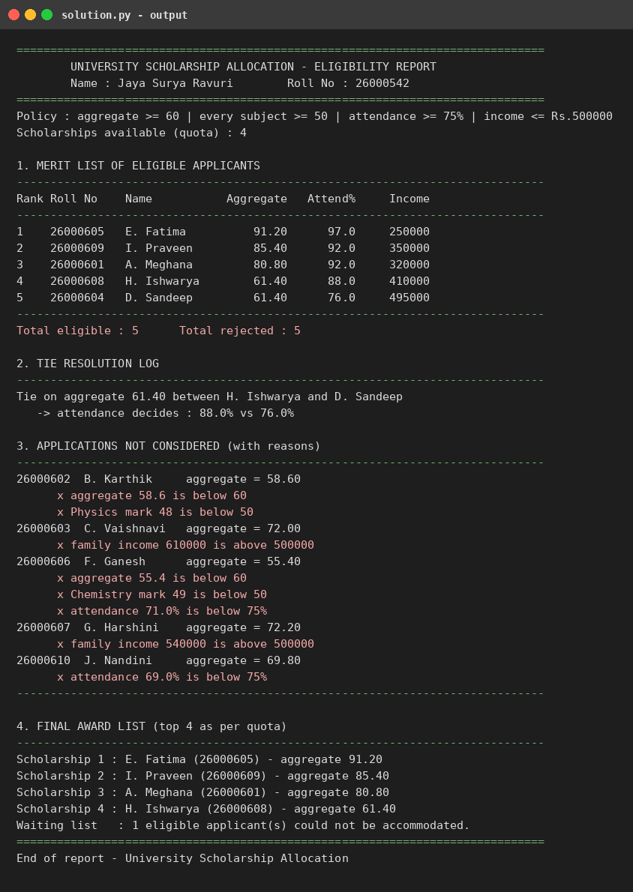

# Case Study 01 — University Scholarship Allocation

**Name:** Jaya Surya Ravuri · **Roll No:** 26000542
**Subject:** Python Programming — Activity-Based Learning

Repository home: [Python-Activity-Based-Learning](../README.md)

---

## 1. Problem Statement

Design a system that evaluates university scholarship applicants using aggregate
marks, subject-wise minimum scores, attendance and family income criteria, ranks
the eligible students and resolves ties using predefined rules.

Every applicant record is available as a tuple

```
(roll_no, name, [marks of 5 subjects], attendance%, annual_family_income)
```

The program must

1. Reject an applicant if the aggregate is below 60 **or** any subject mark is
   below 50 **or** attendance is below 75% **or** family income is above
   ₹5,00,000.
2. Rank all the remaining applicants on aggregate (highest first).
3. Break a tie on aggregate by: higher attendance → lower income → smaller
   roll number.
4. Show every rejected applicant together with the exact reason(s) of rejection.
5. Award the scholarship to the top 4 applicants (the sanctioned quota) and
   print a waiting list.

## 2. Objectives

- Store real-world records using **tuples** and **lists**, and read them back
  with **tuple unpacking**.
- Apply **conditional statements** for multi-criteria eligibility checking.
- Compute the aggregate with **operators** and a **loop**.
- Rank data by building a composite **tie-breaking key** and sorting the list.
- Print a neat tabular report using string formatting.

## 3. Assumptions

- Every applicant has exactly 5 subject marks, each out of 100.
- Aggregate = arithmetic mean of the 5 subject marks.
- `MIN_AGGREGATE = 60`, `MIN_SUBJECT_MARK = 50`, `MIN_ATTENDANCE = 75`,
  `MAX_FAMILY_INCOME = 500000`, `QUOTA = 4`.
- A mark exactly on a limit is **accepted** (the check is strictly `<` or `>`).
- All applicant data used in the program is hypothetical sample data.
- Tie-breaking order is fixed and applied in the order written above.

## 4. Algorithm

```
STEP 1  START
STEP 2  SET MIN_AGGREGATE = 60, MIN_SUBJECT_MARK = 50,
             MIN_ATTENDANCE = 75, MAX_FAMILY_INCOME = 500000, QUOTA = 4
STEP 3  READ the list APPLICANTS (roll, name, marks, attendance, income)
STEP 4  SET eligible = [] , rejected = []
STEP 5  REPEAT for every applicant in APPLICANTS
        5.1  UNPACK applicant -> roll_no, name, marks, attendance, income
        5.2  aggregate = (sum of marks) / number of marks
        5.3  reasons = []
        5.4  IF aggregate < MIN_AGGREGATE
                 append "aggregate below 60" to reasons
        5.5  FOR i = 0 to (number of marks - 1)
                 IF marks[i] < MIN_SUBJECT_MARK
                     append "<subject> mark below 50" to reasons
             END FOR
        5.6  IF attendance < MIN_ATTENDANCE  -> append reason
        5.7  IF income > MAX_FAMILY_INCOME  -> append reason
        5.8  IF reasons is empty
                 append (roll_no, name, aggregate, attendance, income)
                 to eligible
             ELSE
                 append (roll_no, name, aggregate, reasons) to rejected
STEP 6  SORT eligible using key (-aggregate, -attendance, +income, +roll_no)
STEP 7  PRINT the merit list with rank numbers
STEP 8  REPEAT for every pair of adjacent rows in eligible
        8.1  IF both aggregates are equal -> PRINT the tie and how it was broken
STEP 9  PRINT each rejected applicant with all of his / her reasons
STEP 10 PRINT the award list (top QUOTA applicants) and the waiting list count
STEP 11 STOP
```

## 5. Flowchart

The full flowchart is kept in [`../FLOWCHARTS.md`](../FLOWCHARTS.md#1-university-scholarship-allocation).
A short version:

```
        START
          |
   read policy limits and applicant list
          |
   eligible = []  rejected = []
          |
   +--> for each applicant
   |      |
   |      unpack -> roll, name, marks, attendance, income
   |      |
   |      aggregate = sum(marks)/5 ; reasons = []
   |      |
   |      aggregate < 60 or any mark < 50
   |      or attendance < 75 or income > 500000 ?
   |          |                        |
   |         YES                      NO
   |          |                        |
   |      rejected + reasons      eligible + record
   |          |                        |
   |          +-----------+------------+
   |                      |
   +------ more applicants ? --YES--+
                          |
                          NO
                          |
      sort eligible : (-aggregate, -attendance, +income, +roll)
                          |
      print merit list, tie log, rejections, award list
                          |
                         STOP
```

## 6. Pseudocode

```
BEGIN
    MIN_AGGREGATE <- 60
    MIN_SUBJECT_MARK <- 50
    MIN_ATTENDANCE <- 75
    MAX_FAMILY_INCOME <- 500000
    QUOTA <- 4

    eligible <- empty list
    rejected <- empty list

    FOR EACH applicant IN APPLICANTS DO
        (roll, name, marks, attendance, income) <- applicant
        aggregate <- SUM(marks) / COUNT(marks)
        reasons <- empty list

        IF aggregate < MIN_AGGREGATE THEN
            ADD "aggregate below 60" TO reasons
        END IF

        FOR i <- 0 TO COUNT(marks) - 1 DO
            IF marks[i] < MIN_SUBJECT_MARK THEN
                ADD SUBJECTS[i] + " below 50" TO reasons
            END IF
        END FOR

        IF attendance < MIN_ATTENDANCE THEN
            ADD "attendance below 75%" TO reasons
        END IF
        IF income > MAX_FAMILY_INCOME THEN
            ADD "income above limit" TO reasons
        END IF

        IF COUNT(reasons) = 0 THEN
            ADD (roll, name, aggregate, attendance, income) TO eligible
        ELSE
            ADD (roll, name, aggregate, reasons) TO rejected
        END IF
    END FOR

    SORT eligible BY KEY (-aggregate, -attendance, income, roll)

    DISPLAY "Merit list"
    rank <- 1
    FOR EACH record IN eligible DO
        DISPLAY rank, roll, name, aggregate, attendance, income
        rank <- rank + 1
    END FOR

    DISPLAY "Tie resolution"
    FOR i <- 0 TO COUNT(eligible) - 2 DO
        IF eligible[i].aggregate = eligible[i+1].aggregate THEN
            DISPLAY "tie broken by attendance / income / roll number"
        END IF
    END FOR

    DISPLAY "Rejected applications"
    FOR EACH record IN rejected DO
        DISPLAY roll, name, reasons
    END FOR

    DISPLAY "Award list"
    FOR i <- 0 TO QUOTA - 1 DO
        DISPLAY i + 1, eligible[i].name
    END FOR
END
```

## 7. Python Source Code

The program is in [`solution.py`](solution.py).

```
Test data (10 applicants)
26000601 A. Meghana    80.80%  92%  320000
26000602 B. Karthik    58.60%  78%  480000   -> rejected
26000603 C. Vaishnavi  72.00%  84%  610000   -> rejected
...
```

### How to run

```bash
python3 solution.py
```

## 8. Test Cases

The test file is [`test_cases.py`](test_cases.py). Run it with

```bash
python3 test_cases.py
```

| # | Test | Input | Expected result |
|---|------|-------|-----------------|
| TC-01 | Fully eligible applicant | Meghana, 80.80%, 92%, ₹3,20,000 | eligible, no reason |
| TC-02 | Aggregate below 60 | Karthik, 58.60% | rejected, aggregate reason |
| TC-03 | Subject mark below 50 | Karthik, Physics 48 | rejected, Physics reason |
| TC-04 | Income above limit | Vaishnavi, ₹6,10,000 | rejected, income reason only |
| TC-05 | Three rules fail together | Ganesh, 55.40%, Chem 49, 71% | 3 reasons reported |
| TC-06 | Attendance below 75% | Nandini, 69% | rejected, attendance reason |
| TC-07 | Boundary values | 60.00%, exactly 75%, ₹5,00,000 | eligible |
| TC-08 | One mark just below limit | Chemistry 49 | rejected |
| TC-09 | Ranking by aggregate | 75.0 vs 71.0 | 75.0 ranks first |
| TC-10 | Tie on aggregate | same aggregate, 80% vs 60% attendance | 80% ranks first |
| TC-11 | Tie on aggregate and attendance | income ₹2,00,000 vs ₹3,00,000 | lower income ranks first |
| TC-12 | Counting | 10 applicants | exactly 5 eligible |

Result:

```
Passed : 12        Failed : 0
All test cases passed.
```

## 9. Output

```
==============================================================================
        UNIVERSITY SCHOLARSHIP ALLOCATION - ELIGIBILITY REPORT
        Name : Jaya Surya Ravuri        Roll No : 26000542
==============================================================================
Policy : aggregate >= 60 | every subject >= 50 | attendance >= 75% | income <= Rs.500000
Scholarships available (quota) : 4

1. MERIT LIST OF ELIGIBLE APPLICANTS
------------------------------------------------------------------------------
Rank Roll No    Name           Aggregate   Attend%     Income
------------------------------------------------------------------------------
1    26000605   E. Fatima          91.20      97.0     250000
2    26000609   I. Praveen         85.40      92.0     350000
3    26000601   A. Meghana         80.80      92.0     320000
4    26000608   H. Ishwarya        61.40      88.0     410000
5    26000604   D. Sandeep         61.40      76.0     495000
------------------------------------------------------------------------------
Total eligible : 5      Total rejected : 5

2. TIE RESOLUTION LOG
------------------------------------------------------------------------------
Tie on aggregate 61.40 between H. Ishwarya and D. Sandeep
   -> attendance decides : 88.0% vs 76.0%

3. APPLICATIONS NOT CONSIDERED (with reasons)
------------------------------------------------------------------------------
26000602  B. Karthik     aggregate = 58.60
      x aggregate 58.6 is below 60
      x Physics mark 48 is below 50
...
```

The complete output is in [`output.txt`](output.txt) and the screenshot of the
run is [`output_screenshot.png`](output_screenshot.png).



## 10. Conclusion

The case study was completed successfully. All the eligibility conditions were
checked with simple conditional statements, the aggregate was calculated with a
loop, and the merit list was produced by sorting the eligible records with a
composite key made of four values. Because the key is a tuple, Python compares
the aggregate first and automatically moves to attendance, income and roll
number when a tie occurs — so no separate `if` ladder was needed for ranking.
Out of the 10 sample applicants, 5 were eligible, 1 tie was resolved by
attendance, and the top 4 were awarded the scholarship. Tuples turned out to be
a good choice for the records because the data of a student is not supposed to
change once it is entered.
