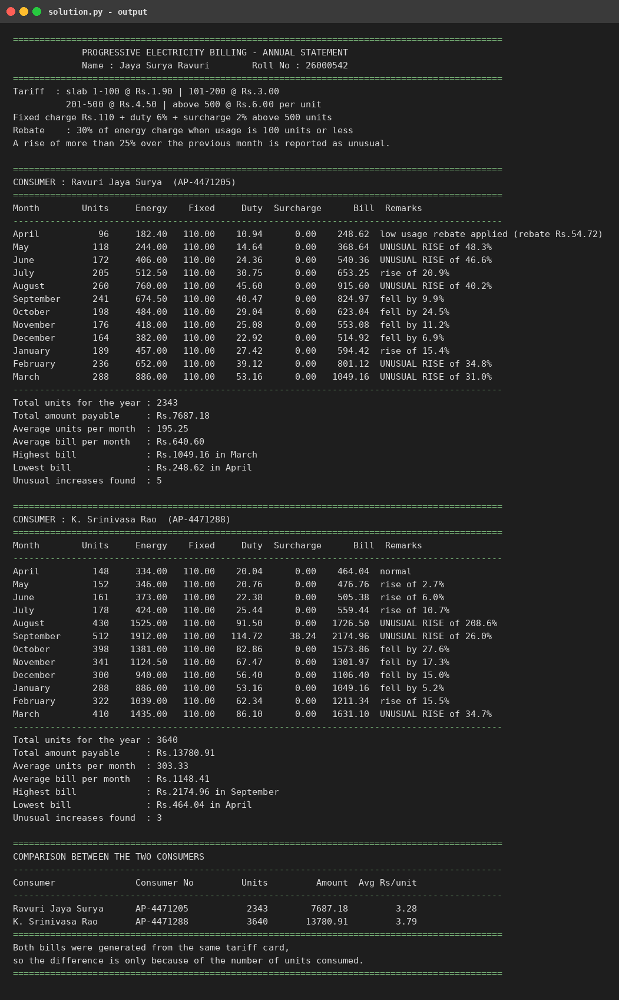

# Case Study 02 — Progressive Electricity Billing

**Name:** Jaya Surya Ravuri · **Roll No:** 26000542
**Subject:** Python Programming — Activity-Based Learning

Repository home: [Python-Activity-Based-Learning](../README.md)

---

## 1. Problem Statement

A domestic electricity supply company bills its consumers on a **progressive
slab tariff**. The unit rate keeps increasing as the consumption crosses a slab,
a fixed charge is added every month, electricity duty is charged as a percentage
of the energy charge, a surcharge is added for very high consumption and a
rebate is given for very low consumption.

The program must

1. Calculate the monthly bill of a household from the number of units consumed
   using the slab tariff.
2. Add the fixed charge, the electricity duty, the high-usage surcharge and the
   low-usage rebate in the correct order.
3. Repeat this for **twelve months** and print a month-wise bill register.
4. Compare the bill of every month with the previous month and **flag any
   increase greater than 25 %** as an unusual increase.
5. Compare the yearly totals of two different consumers.

### Tariff used

| Slab (units) | Rate per unit |
|---|---|
| 1 – 100 | ₹1.90 |
| 101 – 200 | ₹3.00 |
| 201 – 500 | ₹4.50 |
| above 500 | ₹6.00 |

Additional rules: fixed charge ₹110 per month, electricity duty 6 % of the
energy charge, surcharge 2 % of the energy charge when units > 500, rebate 30 %
of the energy charge when units ≤ 100.

## 2. Objectives

- Use a **list of tuples** `(lower, upper, rate)` as a tariff table.
- Traverse the slabs with a **loop** and a **conditional statement** to compute
  the progressive charge.
- Apply **operators** for percentage calculations.
- Keep the monthly readings in a **list** and process them in a loop.
- Compare consecutive months and detect unusual increases using a threshold.
- Print a formatted, aligned bill register.

## 3. Assumptions

- One month has a single meter reading, so only one "units" value per month.
- Units are always non-negative whole numbers.
- Bill is rounded to two decimal places only while printing.
- The surcharge and the rebate are never applicable to the same month, because
  one needs units > 500 and the other needs units ≤ 100.
- The previous month's bill is needed for the comparison, so the first month
  (April) has no percentage-change remark.
- All consumer names and readings are hypothetical sample data.

## 4. Algorithm

```
STEP 1  START
STEP 2  DEFINE SLABS = [(1,100,1.90), (101,200,3.00), (201,500,4.50),
                        (501,1000000,6.00)]
        FIXED_CHARGE = 110, DUTY = 6%, SURCHARGE = 2%, REBATE = 30%,
        UNUSUAL_RISE = 25%
STEP 3  READ the consumer list (consumer_no, name, twelve monthly units)
STEP 4  REPEAT for every consumer
        4.1  PRINT the consumer heading
        4.2  SET previous_bill = -1, total_units = 0, total_bill = 0
        4.3  REPEAT for month = 0 to 11
               4.3.1  units = monthly_units[month]
               4.3.2  SET charge = 0, left = units
               4.3.3  REPEAT for every slab (lower, upper, rate)
                        width = upper - lower + 1
                        IF left = 0 THEN exit loop
                        IF left > width THEN used = width
                                          ELSE used = left
                        charge = charge + used * rate
                        left   = left - used
                      END REPEAT
               4.3.4  duty = charge * 6 / 100
               4.3.5  IF units > 500 THEN surcharge = charge * 2 / 100
                      ELSE surcharge = 0
               4.3.6  IF units <= 100 THEN rebate = charge * 30 / 100
                      ELSE rebate = 0
               4.3.7  total = charge + fixed + duty + surcharge - rebate
               4.3.8  IF previous_bill >= 0 THEN
                          change = (total - previous_bill) / previous_bill * 100
                          IF change > 25 THEN remark = "UNUSUAL RISE"
               4.3.9  PRINT the row of the register
               4.3.10 previous_bill = total
                      total_units = total_units + units
                      total_bill  = total_bill  + total
             END REPEAT
        4.4  PRINT totals, averages, highest and lowest bill, number of rises
STEP 5  PRINT the comparison table of both consumers
STEP 6  STOP
```

## 5. Flowchart

The full flowchart is in [`../FLOWCHARTS.md`](../FLOWCHARTS.md#2-progressive-electricity-billing).
Short version:

```
     START
       |
  read tariff + consumer readings
       |
  for each consumer ----------------------+
       |                                  |
  previous_bill = -1, totals = 0          |
       |                                  |
  for each month ---------------------+   |
       |                             |   |
  charge = 0, left = units           |   |
       |                             |   |
  for each slab ------------------+  |   |
       |                          |  |   |
  left > 0 ? --NO--> next slab ---+  |   |
       | YES                          |   |
  left > width ?                      |   |
      YES -> charge += width*rate     |   |
      NO  -> charge += left*rate      |   |
       |                              |   |
       +------------------------------+   |
       |                                  |
  bill = charge + fixed + duty + surcharge - rebate
       |                                  |
  previous bill exists ?                  |
      YES -> change% , flag if > 25%      |
       |                                  |
  print row, update previous bill         |
       +----------------------------------+
       |
  print yearly summary
       +----------------------------------+
       |
  print comparison table
       |
      STOP
```

## 6. Pseudocode

```
BEGIN
    SLABS <- [(1,100,1.90),(101,200,3.00),(201,500,4.50),(501,1000000,6.00)]
    FIXED <- 110
    DUTY_PERCENT <- 6
    SURCHARGE_PERCENT <- 2
    REBATE_PERCENT <- 30
    RISE_LIMIT <- 25

    FOR EACH consumer IN CONSUMERS DO
        (cno, name, units_list) <- consumer
        DISPLAY "Consumer", cno, name
        previous <- -1
        sum_units <- 0
        sum_bill <- 0

        FOR m <- 0 TO 11 DO
            units <- units_list[m]
            charge <- 0
            left <- units

            FOR EACH (lower, upper, rate) IN SLABS DO
                IF left = 0 THEN EXIT FOR
                width <- upper - lower + 1
                IF left > width THEN
                    used <- width
                ELSE
                    used <- left
                END IF
                charge <- charge + used * rate
                left <- left - used
            END FOR

            duty <- charge * DUTY_PERCENT / 100
            IF units > 500 THEN
                surcharge <- charge * SURCHARGE_PERCENT / 100
            ELSE
                surcharge <- 0
            END IF
            IF units <= 100 THEN
                rebate <- charge * REBATE_PERCENT / 100
            ELSE
                rebate <- 0
            END IF

            bill <- charge + FIXED + duty + surcharge - rebate

            IF previous >= 0 THEN
                change <- (bill - previous) / previous * 100
                IF change > RISE_LIMIT THEN
                    remark <- "UNUSUAL RISE"
                ELSE
                    remark <- "change of " + change + "%"
                END IF
            ELSE
                remark <- "normal"
            END IF

            DISPLAY MONTHS[m], units, charge, FIXED, duty, surcharge, bill, remark
            previous <- bill
            sum_units <- sum_units + units
            sum_bill <- sum_bill + bill
        END FOR

        DISPLAY "Total units", sum_units
        DISPLAY "Total amount", sum_bill
        DISPLAY "Average per month", sum_bill / 12
    END FOR
END
```

## 7. Python Source Code

The program is in [`solution.py`](solution.py).

```bash
python3 solution.py
```

## 8. Test Cases

The test file is [`test_cases.py`](test_cases.py).

| # | Test | Input | Expected |
|---|------|-------|----------|
| TC-01 | No consumption | 0 units | charge 0.00 |
| TC-02 | Inside slab 1 | 50 units | 95.00 |
| TC-03 | Slab 1 boundary | 100 units | 190.00 |
| TC-04 | One unit into slab 2 | 101 units | 193.00 |
| TC-05 | Two slabs | 200 units | 490.00 |
| TC-06 | Three slabs | 500 units | 1840.00 |
| TC-07 | All four slabs | 512 units | 1912.00 |
| TC-08 | Progressive is cheaper | 512 units | less than 512 × 6 |
| TC-09 | Low usage rebate | 100 units | rebate 57.00 |
| TC-10 | No rebate / no surcharge | 150 units | both 0 |
| TC-11 | High usage surcharge | 512 units | 38.24 |
| TC-12 | Duty percentage | 200 units | 29.40 |
| TC-13 | Total bill | 200 units | 629.40 |
| TC-14 | Monotonic bill | 200 → 300 units | bill increases |
| TC-15 | Slab break-up text | 201 units | "100 x 1.90 + 100 x 3.00 + 1 x 4.50" |

Result:

```
Passed : 15        Failed : 0
All test cases passed.
```

## 9. Output

```
Month        Units     Energy    Fixed     Duty  Surcharge      Bill  Remarks
--------------------------------------------------------------------------------------------
April           96     182.40   110.00    10.94      0.00    248.62  low usage rebate applied (rebate Rs.54.72)
May            118     244.00   110.00    14.64      0.00    368.64  UNUSUAL RISE of 48.3%
June           172     406.00   110.00    24.36      0.00    540.36  UNUSUAL RISE of 46.6%
July           205     512.50   110.00    30.75      0.00    653.25  rise of 20.9%
August         260     760.00   110.00    45.60      0.00    915.60  UNUSUAL RISE of 40.2%
...
September      512    1912.00   110.00   114.72     38.24   2174.96  UNUSUAL RISE of 26.0%
--------------------------------------------------------------------------------------------
Total units for the year : 3640
Total amount payable     : Rs.13780.91
```

The complete output is in [`output.txt`](output.txt) and the screenshot of the
run is [`output_screenshot.png`](output_screenshot.png).



## 10. Conclusion

The progressive billing system was built and tested successfully. The slab loop
correctly charges only the number of units that actually fall inside a slab, so
a consumer who uses 512 units does not pay ₹6 for all 512 units. Out of the two
sample consumers, the first one used 2343 units and paid ₹7,687.18 while the
second one used 3640 units and paid ₹13,780.91, which shows that the progressive
tariff makes heavy consumption considerably more expensive per unit. Five months
of the first consumer and three months of the second consumer crossed the 25 %
rise limit and were flagged. While testing, one interesting difficulty was the
"units left in this slab" bookkeeping — it had to be handled with a `left`
counter that is reduced after every slab, otherwise the same units get charged
twice.
