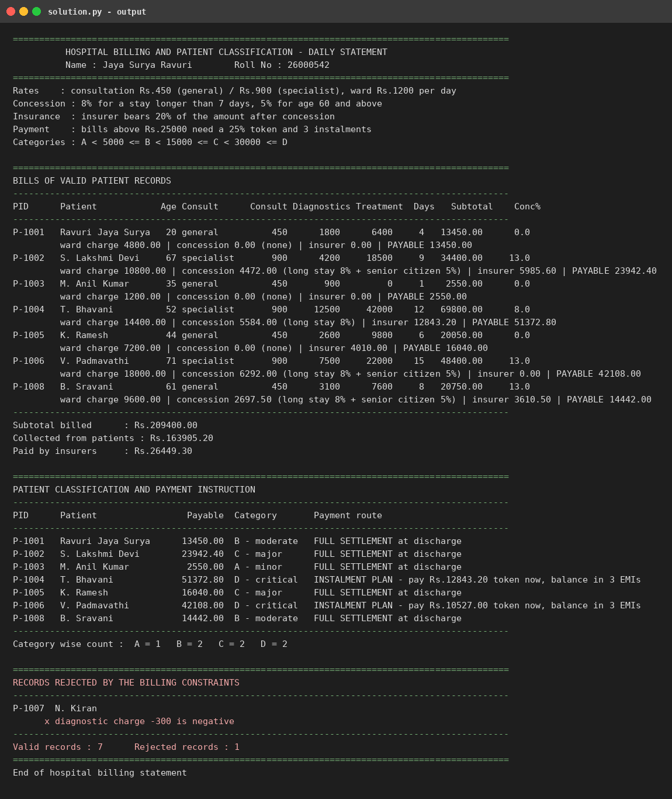

# Case Study 03 — Hospital Billing and Patient Classification

**Name:** Jaya Surya Ravuri · **Roll No:** 26000542
**Subject:** Python Programming — Activity-Based Learning

Repository home: [Python-Activity-Based-Learning](../README.md)

---

## 1. Problem Statement

A multi-speciality hospital wants a small program that can prepare the bill of
every patient at the end of the day. Each patient record has a consultation
charge, a diagnostics charge, a treatment charge and a number of days spent in
the ward. Conditional concessions are to be applied, the record has to be
validated before billing, and finally the patient must be classified according
to the hospital's payment policy.

The program must

1. **Validate** each record — no negative charge, no stay beyond 60 days, a known
   consultant type, a known payment mode and a consultation fee that matches the
   consultant type.
2. Compute the bill as `consultation + diagnostics + treatment + (days × ward rate)`.
3. Apply concessions: **8 %** for a stay longer than 7 days and **5 %** for a
   patient aged 60 or above (both can apply together).
4. If the patient is insured, the insurer pays **20 %** of the amount that is
   left after the concession.
5. **Classify** the final payable amount: A < ₹5,000 ≤ B < ₹15,000 ≤ C < ₹30,000 ≤ D.
6. Print a classification table, a payment instruction and a summary of how many
   patients fall in each category.

## 2. Objectives

- Represent a record using a **tuple** with nine fields and read it with
  **tuple unpacking**.
- Use a **list** of such tuples as the day's register.
- Validate the input with **conditional statements** and collect the error
  messages in a **list**.
- Apply **operators** for percentages and the ward charge.
- Write small reusable **functions** so that the same bill is not calculated
  twice in the report.
- Keep category counts in a **list / dictionary** and print a summary.

## 3. Assumptions

- General consultation is ₹450 and specialist consultation is ₹900.
- The ward charge is ₹1,200 per day for every patient.
- A "stay longer than 7 days" means 8 days or more; exactly 7 days gets nothing.
- Age 60 is already a senior citizen.
- The insurer's share is calculated **after** the concession, not before.
- Discharge on the same day is not possible, so a valid record has at least 1
  ward day.
- All patient details used in the program are hypothetical sample data.

## 4. Algorithm

```
STEP 1  START
STEP 2  SET RATES and POLICY constants
        GENERAL_FEE = 450, SPECIALIST_FEE = 900, WARD = 1200,
        MAX_STAY = 60, LONG_STAY_DAYS = 7, LONG_STAY_CONCESSION = 8%,
        SENIOR_AGE = 60, SENIOR_CONCESSION = 5%, INSURANCE_SHARE = 20%,
        POLICY_LIMIT = 25000, MIN_TOKEN = 25%
STEP 3  READ the list of patient records
STEP 4  SET valid = [] , rejected = []
STEP 5  REPEAT for every record in the list
        5.1  problems = VALIDATE(record)
        5.2  IF problems is empty  ->  add record to valid
             ELSE                   ->  add (record, problems) to rejected
STEP 6  REPEAT for every record in valid
        6.1  UNPACK record -> pid, name, age, type, consult, diag, treat,
                              days, mode
        6.2  ward = days * WARD
        6.3  subtotal = consult + diag + treat + ward
        6.4  percent = 0
        6.5  IF days > LONG_STAY_DAYS   -> percent = percent + 8
        6.6  IF age >= SENIOR_AGE       -> percent = percent + 5
        6.7  concession = subtotal * percent / 100
        6.8  after = subtotal - concession
        6.9  IF mode = "insured"        -> insurer = after * 20 / 100
             ELSE                        -> insurer = 0
        6.10 payable = after - insurer
        6.11 PRINT the bill lines
        6.12 category = CLASSIFY(payable)
        6.13 count[category] = count[category] + 1
STEP 7  REPEAT for every record in valid
        7.1  PRINT payable, category and the payment instruction
STEP 8  PRINT the category wise counts
STEP 9  PRINT every rejected record with all its problems
STEP 10 STOP

FUNCTION VALIDATE(record)
    problems = []
    IF age not in 0..120               -> add problem
    IF any charge is negative          -> add problem
    IF days > MAX_STAY                 -> add problem
    IF consultant type is unknown      -> add problem
    IF payment mode is unknown         -> add problem
    IF fee does not match the type     -> add problem
    RETURN problems
END FUNCTION

FUNCTION CLASSIFY(payable)
    IF payable < 5000   THEN RETURN "A - minor"
    ELSE IF payable < 15000 THEN RETURN "B - moderate"
    ELSE IF payable < 30000 THEN RETURN "C - major"
    ELSE RETURN "D - critical"
END FUNCTION
```

## 5. Flowchart

The full flowchart is in
[`../FLOWCHARTS.md`](../FLOWCHARTS.md#3-hospital-billing-and-patient-classification).
Short version:

```
        START
          |
   read rates + patient records
          |
  valid = []   rejected = []
          |
  +--> for each record
  |      |
  |   validate record
  |      |
  |   any problem ? --YES--> rejected + problems ---+
  |      | NO                                       |
  |      |                                          |
  |   ward = days x 1200                            |
  |   subtotal = consult + diag + treat + ward      |
  |   days > 7 ?    YES -> +8%                      |
  |   age >= 60 ?   YES -> +5%                      |
  |   concession applied                            |
  |   insured ?     YES -> insurer pays 20%         |
  |   payable = balance                             |
  |      |                                          |
  |   classify payable into A / B / C / D           |
  |   count category, print bill                    |
  |      |                                          |
  +------+------------------------------------------+
          |
   print classification + payment instruction
          |
   print category counts and rejected records
          |
         STOP
```

## 6. Pseudocode

```
BEGIN
    FOR EACH record IN PATIENTS DO
        problems <- VALIDATE(record)
        IF LENGTH(problems) = 0 THEN
            ADD record TO valid
        ELSE
            ADD (record, problems) TO rejected
        END IF
    END FOR

    count <- {A:0, B:0, C:0, D:0}

    FOR EACH record IN valid DO
        (pid, name, age, ctype, consult, diag, treat, days, mode) <- record
        ward <- days * WARD_CHARGE_PER_DAY
        subtotal <- consult + diag + treat + ward

        percent <- 0
        IF days > LONG_STAY_DAYS THEN percent <- percent + 8 END IF
        IF age >= SENIOR_AGE THEN percent <- percent + 5 END IF

        concession <- subtotal * percent / 100
        after <- subtotal - concession

        IF mode = "insured" THEN
            insurer <- after * INSURANCE_SHARE / 100
        ELSE
            insurer <- 0
        END IF

        payable <- after - insurer
        DISPLAY pid, name, subtotal, concession, insurer, payable

        category <- CLASSIFY(payable)
        count[FIRST LETTER OF category] <- count[...] + 1

        IF payable <= POLICY_LIMIT THEN
            route <- "FULL SETTLEMENT at discharge"
        ELSE
            token <- payable * MIN_TOKEN_PERCENT / 100
            route <- "INSTALMENT PLAN, token " + token
        END IF
        DISPLAY category, route
    END FOR

    DISPLAY count
    FOR EACH (record, problems) IN rejected DO
        DISPLAY record.pid, record.name, problems
    END FOR
END
```

## 7. Python Source Code

The program is in [`solution.py`](solution.py).

```bash
python3 solution.py
```

## 8. Test Cases

The test file is [`test_cases.py`](test_cases.py).

| # | Test | Input | Expected |
|---|------|-------|----------|
| TC-01 | Clean record | P-1001 | no problem |
| TC-02 | Negative diagnostics | P-1007, −300 | rejected |
| TC-03 | Very long stay | 75 days | rejected |
| TC-04 | Wrong fee for specialist | specialist, ₹450 | rejected |
| TC-05 | Unknown consultant type | "surgeon" | rejected |
| TC-06 | Plain bill | 4 days, general | subtotal 13,450 |
| TC-07 | No concession, no insurance | same | payable 13,450 |
| TC-08 | Both concessions | 9 days, age 67 | 13 % |
| TC-09 | Concession amount | subtotal 34,400 | 4,472 |
| TC-10 | Insurer share | after concession | 5,985.60 |
| TC-11 | Final payable | − | 23,942.40 |
| TC-12 | Exactly 7 days | 7 days | no concession |
| TC-13 | 8 days | 8 days | 8 % |
| TC-14 | Age exactly 60 | 60 | 5 % |
| TC-15..18 | Category boundaries | 4,999 / 5,000 / 15,000 / 30,000 | A / B / C / D |
| TC-19..20 | Payment plan threshold | 25,000 / 25,001 | full / instalment |
| TC-21 | Counting | 8 records | 1 rejected |

Result:

```
Passed : 21        Failed : 0
All test cases passed.
```

## 9. Output

```
BILLS OF VALID PATIENT RECORDS
----------------------------------------------------------------------------------------------
PID      Patient            Age Consult      Consult Diagnostics Treatment  Days   Subtotal    Conc%
----------------------------------------------------------------------------------------------
P-1001   Ravuri Jaya Surya   20 general          450      1800      6400     4   13450.00      0.0
         ward charge 4800.00 | concession 0.00 (none) | insurer 0.00 | PAYABLE 13450.00
P-1002   S. Lakshmi Devi     67 specialist       900      4200     18500     9   34400.00     13.0
         ward charge 10800.00 | concession 4472.00 (long stay 8% + senior citizen 5%) | insurer 5985.60 | PAYABLE 23942.40
...
----------------------------------------------------------------------------------------------
Subtotal billed      : Rs.209400.00
Collected from patients : Rs.163905.20
Paid by insurers     : Rs.26449.30

Category wise count :  A = 1   B = 2   C = 2   D = 2
```

The complete output is in [`output.txt`](output.txt) and the screenshot is
[`output_screenshot.png`](output_screenshot.png).



## 10. Conclusion

The hospital billing program works correctly for all the eight sample records.
Seven records passed the validation and one record (P-1007) was rejected because
of a negative diagnostics charge, which shows that validating the data before
billing is important. The concessions behaved as expected: a 9-day stay for a
67-year-old patient received 13 % together, while a 4-day stay for a 20-year-old
received nothing. Out of the seven valid patients, one fell in category A, two in
B, two in C and two in D, and the two category D patients were routed to the
instalment plan. The main lesson from this case study was that the order of
calculation matters — applying the insurance share before the concession would
have given a different (and wrong) payable amount.
