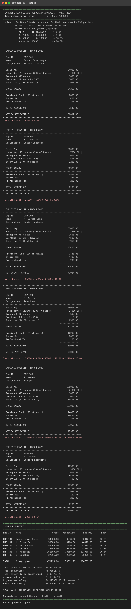

# Case Study 04 — Employee Payroll and Deduction Analysis

**Name:** Jaya Surya Ravuri · **Roll No:** 26000542
**Subject:** Python Programming — Activity-Based Learning

Repository home: [Python-Activity-Based-Learning](../README.md)

---

## 1. Problem Statement

A company wants a payroll program for the month of March. For every employee
the gross salary has to be built from the basic pay, the house rent allowance,
the transport allowance, the overtime pay and the incentive. After that the
provident fund, the professional tax and a **progressive** income tax have to be
deducted and a formatted salary statement has to be printed.

The program must

1. Compute `HRA = 20 % of basic`, `transport = ₹1,600`,
   `overtime = hours × ₹250`, `incentive = incentive% of basic`.
2. Compute `gross = basic + HRA + transport + overtime + incentive`.
3. Deduct `PF = 12 % of basic`, `professional tax = ₹200` and the income tax
   computed from progressive slabs on the **gross** salary.
4. Print a formatted payslip (box drawn with `+ - |` characters) for each
   employee.
5. Print a payroll summary with the gross, the deductions, the net pay and the
   deduction percentage for everybody, plus the team totals.
6. Flag any employee whose deductions cross **50 % of the gross salary** in an
   audit list.

### Tax slabs on the monthly gross

| Gross salary | Rate |
|---|---|
| up to ₹25,000 | 0 % |
| ₹25,000 – ₹50,000 | 5 % |
| ₹50,000 – ₹1,00,000 | 10 % |
| above ₹1,00,000 | 20 % |

## 2. Objectives

- Keep the master data in a **list of tuples** and read each record with
  **tuple unpacking**.
- Implement a **progressive slab** calculation with a loop.
- Format money in aligned columns using the `%` operator and field widths.
- Draw a box around the payslip using string repetition.
- Collect the audit records in a second **list** while processing.
- Compute team totals and find the highest / lowest net salary with a loop.

## 3. Assumptions

- A month has 30 days and the overtime rate is uniform for everyone.
- Transport allowance and professional tax are fixed amounts and do not depend
  on the basic pay.
- The income tax is calculated on the monthly gross, slab by slab, so the
  higher rate applies only to the part of the salary that falls in that slab.
- The incentive percentage is stored in the employee record, so it is an input
  and not calculated.
- Only one month is processed, so no year-to-date figures are needed.
- All names and salaries are hypothetical sample data.

## 4. Algorithm

```
STEP 1  START
STEP 2  SET HRA_PERCENT = 20, TRANSPORT = 1600, OT_RATE = 250,
        PF_PERCENT = 12, PROFESSIONAL_TAX = 200, AUDIT_LIMIT = 50
STEP 3  DEFINE TAX_SLABS = [(0,25000,0%), (25000,50000,5%),
                            (50000,100000,10%), (100000,-1,20%)]
STEP 4  READ the employee records
STEP 5  REPEAT for every employee
        5.1  UNPACK record -> emp_id, name, designation, basic, ot_hours, incentive%
        5.2  hra = basic * 20 / 100
        5.3  overtime = ot_hours * 250
        5.4  incentive = basic * incentive% / 100
        5.5  gross = basic + hra + 1600 + overtime + incentive
        5.6  tax = 0
             FOR each slab (lower, upper, rate)
                 IF gross <= lower THEN exit loop
                 IF upper = -1        THEN taxable = gross - lower
                 ELSE IF gross > upper THEN taxable = upper - lower
                 ELSE                      taxable = gross - lower
                 tax = tax + taxable * rate / 100
             END FOR
        5.7  pf = basic * 12 / 100
        5.8  deductions = pf + tax + 200
        5.9  net = gross - deductions
        5.10 PRINT the payslip box
        5.11 IF deductions > 50% of gross -> add the employee to the audit list
STEP 6  PRINT the payroll summary table and the team totals
STEP 7  PRINT the highest and the lowest net salary
STEP 8  PRINT the audit list
STEP 9  STOP
```

## 5. Flowchart

The full flowchart is in
[`../FLOWCHARTS.md`](../FLOWCHARTS.md#4-employee-payroll-and-deduction-analysis).
Short version:

```
     START
       |
  read pay rules + employee list
       |
  for each employee ---------------------+
       |                                 |
  unpack (id, name, basic, ot, inc%)     |
       |                                 |
  hra, overtime, incentive               |
  gross = basic + hra + 1600 + ot + inc  |
       |                                 |
  for each tax slab ---+                 |
       |               |                 |
  gross > lower ?      |                 |
     NO  -> exit tax loop                |
     YES -> tax += taxable x rate        |
       +---------------+                 |
       |                                 |
  pf = 12% of basic                      |
  deductions = pf + tax + 200            |
  net = gross - deductions               |
       |                                 |
  print payslip                          |
       |                                 |
  deductions > 50% of gross ?            |
     YES -> add to audit list            |
       +---------------------------------+
       |
  print summary + totals + highest/lowest
       |
  print audit list
       |
      STOP
```

## 6. Pseudocode

```
BEGIN
    FOR EACH emp IN EMPLOYEES DO
        (emp_id, name, designation, basic, ot_hours, incentive_percent) <- emp

        hra <- basic * HRA_PERCENT / 100
        overtime <- ot_hours * OVERTIME_RATE
        incentive <- basic * incentive_percent / 100
        gross <- basic + hra + TRANSPORT_ALLOWANCE + overtime + incentive

        tax <- 0
        FOR EACH (lower, upper, rate) IN TAX_SLABS DO
            IF gross <= lower THEN EXIT FOR END IF
            IF upper = -1 THEN
                taxable <- gross - lower
            ELSE IF gross > upper THEN
                taxable <- upper - lower
            ELSE
                taxable <- gross - lower
            END IF
            tax <- tax + taxable * rate / 100
        END FOR

        pf <- basic * PF_PERCENT / 100
        deductions <- pf + tax + PROFESSIONAL_TAX
        net <- gross - deductions

        DISPLAY payslip box with basic, hra, transport, overtime, incentive
        DISPLAY gross, pf, tax, professional tax, deductions, net
        DISPLAY tax slab break up

        IF deductions > gross * AUDIT_LIMIT / 100 THEN
            ADD (name, deductions / gross * 100) TO audit
        END IF

        ADD (emp_id, name, gross, deductions, net) TO summary
    END FOR

    DISPLAY summary table
    DISPLAY total gross, total deductions, total net, average net
    DISPLAY highest net salary and lowest net salary
    DISPLAY audit list
END
```

## 7. Python Source Code

The program is in [`solution.py`](solution.py).

```bash
python3 solution.py
```

## 8. Test Cases

The test file is [`test_cases.py`](test_cases.py).

| # | Test | Input | Expected |
|---|------|-------|----------|
| TC-01 | No tax in the first slab | ₹25,000 | 0.00 |
| TC-02 | Second slab only | ₹30,000 | 250.00 |
| TC-03 | Full second slab | ₹50,000 | 1,250.00 |
| TC-04 | Two slabs | ₹60,000 | 2,250.00 |
| TC-05 | Three slabs | ₹1,20,000 | 10,250.00 |
| TC-06 | Zero income | ₹0 | 0.00 |
| TC-07 | HRA | basic 24,000 | 4,800.00 |
| TC-08 | Overtime | 12 hours | 3,000.00 |
| TC-09 | Incentive | 4 % of 24,000 | 960.00 |
| TC-10 | Gross salary | EMP-101 | 34,360.00 |
| TC-11 | Provident fund | 12 % of 24,000 | 2,880.00 |
| TC-12 | Income tax | gross 34,360 | 468.00 |
| TC-13 | Total deductions | EMP-101 | 3,548.00 |
| TC-14 | Net salary | EMP-101 | 30,812.00 |
| TC-15 | Net = gross − deductions | all 6 | true |
| TC-16 | Gross = sum of earnings | EMP-105 | true |
| TC-17 | Zero overtime | EMP-104 | 0.00 |
| TC-18 | Positive net salary | lowest paid | > 0 |
| TC-19 | Highest net salary | EMP-105 | 1,27,950.00 |
| TC-20 | Slab break-up text | ₹60,000 | "25000 x 5.0% + 10000 x 10.0%" |

Result:

```
Passed : 20        Failed : 0
All test cases passed.
```

## 9. Output

```
| Emp ID      : EMP-101                                    |
| Name        : Ravuri Jaya Surya                          |
| Designation : Software Trainee                           |
+----------------------------------------------------------+
| Basic Pay                                       24000.00 |
| House Rent Allowance (20% of basic)               4800.00 |
| Transport Allowance                              1600.00 |
| Overtime (12 hrs x Rs.250)                       3000.00 |
| Incentive (4.0% of basic)                         960.00 |
|                                           -------------- |
| GROSS SALARY                                    34360.00 |
+----------------------------------------------------------+
| Provident Fund (12% of basic)                    2880.00 |
| Income Tax                                        468.00 |
| Professional Tax                                  200.00 |
|                                           -------------- |
| TOTAL DEDUCTIONS                                 3548.00 |
+----------------------------------------------------------+
| NET SALARY PAYABLE                              30812.00 |
+----------------------------------------------------------+
Tax slabs used : 9360 x 5.0%

Emp ID    Name                        Gross   Deductions      Net Pay       Ded%
------------------------------------------------------------------------------------------------
EMP-101   Ravuri Jaya Surya        34360.00      3548.00     30812.00      10.3%
...
TOTAL     6 employees             471295.00     76511.75    394783.25
```

The complete output is in [`output.txt`](output.txt) and the screenshot is
[`output_screenshot.png`](output_screenshot.png).



## 10. Conclusion

The payroll program produced correct payslips for all six employees and the
cross-checks in the test file confirm that `net = gross − deductions` holds for
every record. The progressive tax was the tricky part: the first version of the
slab table printed a tax of ₹467.95 instead of ₹468 because the slab boundary
was being counted twice (the slab was written as 0–25000 and 25001–50000). After
changing the table to use `(from, up_to)` values and computing
`taxable = amount − from`, the tax came out exactly right for every salary. The
team's total gross salary is ₹4,71,295.00, the total deduction is ₹76,511.75 and
the amount to be transferred is ₹3,94,783.25. No employee crossed the 50 % audit
limit this month, which is expected because the highest deduction percentage is
only about 20 %.
