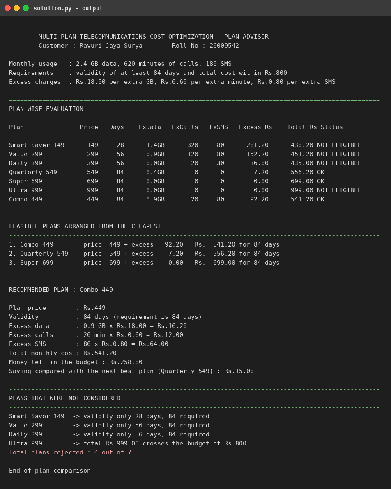

# Case Study 05 — Multi-Plan Telecommunications Cost Optimization

**Name:** Jaya Surya Ravuri · **Roll No:** 26000542
**Subject:** Python Programming — Activity-Based Learning

Repository home: [Python-Activity-Based-Learning](../README.md)

---

## 1. Problem Statement

A telecom operator sells several prepaid plans. Every plan has a price, a data
limit, a free-call limit, a free-SMS limit and a validity period. If the customer
uses more than the limit of a plan, extra charges apply. The customer wants to
choose **the most economical plan that is actually usable** for his usage,
validity requirement and budget.

The program must

1. Store the customer's monthly usage and requirement in the program
   (2.4 GB data, 620 minutes, 180 SMS, validity of at least 84 days, budget ₹800).
2. For every plan in the plan table compute the excess data, the excess minutes
   and the excess SMS, then the excess amount and the total cost.
3. Reject a plan whose validity is shorter than the required validity, and also
   reject a plan whose total cost crosses the budget.
4. Arrange the remaining (feasible) plans from the cheapest to the costliest and
   show the **best plan** with the extra charges broken up.
5. Show how much money is left in the budget and how much is saved against the
   next best plan.
6. Explain why each rejected plan was rejected.

### Plans offered

| Plan | Price (₹) | Data (GB) | Calls (min) | SMS | Validity |
|---|---|---|---|---|---|
| Smart Saver 149 | 149 | 1.0 | 300 | 100 | 28 days |
| Value 299 | 299 | 1.5 | 500 | 100 | 56 days |
| Daily 399 | 399 | 2.5 | 600 | 150 | 56 days |
| Quarterly 549 | 549 | 2.0 | 750 | 300 | 84 days |
| Super 699 | 699 | 3.0 | 1000 | 300 | 84 days |
| Ultra 999 | 999 | 3.5 | 1500 | 500 | 84 days |
| Combo 449 | 449 | 1.5 | 600 | 100 | 84 days |

Excess charges: ₹18 per GB, ₹0.60 per minute and ₹0.80 per SMS.

## 2. Objectives

- Store a plan as a **tuple** of six values and unpack it inside a function.
- Use **conditional statements** to check the validity and the budget
  constraints.
- Compute the excess usage with simple **comparisons** and **operators**.
- Keep the result of every plan in a **list** so that it can be sorted later.
- Sort the feasible **list** with a manual swap loop and a tie-break rule
  (equal cost → more validity wins).
- Handle the situation where the feasible list becomes empty.

## 3. Assumptions

- Only one customer is considered and the usage is the same every month.
- The validity requirement is 84 days (one quarter) and the budget is ₹800.
- Excess minutes and SMS are whole numbers; excess data can be fractional.
- A plan whose validity is exactly equal to the requirement is accepted.
- The excess charges do not have any upper cap.
- Every plan's price is for its full validity period, so the totals of plans with
  different validity are compared on the "cost for one requirement period"
  basis, which is why short-validity plans are rejected first.
- All plan details are hypothetical sample data.

## 4. Algorithm

```
STEP 1  START
STEP 2  SET usage = 2.4 GB, 620 min, 180 SMS
        SET VALIDITY_NEEDED = 84, BUDGET = 800
        SET EXCESS_DATA_RATE = 18, EXCESS_CALL_RATE = 0.60, EXCESS_SMS_RATE = 0.80
STEP 3  READ the plan table
STEP 4  SET results = []
STEP 5  REPEAT for every plan
        5.1  UNPACK plan -> name, price, data, calls, sms, days
        5.2  eligible = TRUE
        5.3  IF days < VALIDITY_NEEDED -> eligible = FALSE, reason = validity
        5.4  excess_data  = 0 ; IF usage_data > data  -> usage_data - data
        5.5  excess_calls = 0 ; IF usage_calls > calls -> usage_calls - calls
        5.6  excess_sms   = 0 ; IF usage_sms > sms   -> usage_sms - sms
        5.7  excess_amount = excess_data*18 + excess_calls*0.60 + excess_sms*0.80
        5.8  total = price + excess_amount
        5.9  IF eligible AND total > BUDGET -> eligible = FALSE, reason = budget
        5.10 add [name, price, days, excess_data, excess_calls, excess_sms,
                  excess_amount, total, eligible, within_budget, reason]
             to results
STEP 6  PRINT the plan-wise evaluation table
STEP 7  BUILD feasible = [ r in results where r is eligible ]
STEP 8  IF feasible is empty -> PRINT a message and STOP
STEP 9  SORT feasible by total cost ascending,
        and for equal total by more validity days
STEP 10 PRINT the ranked feasible plans
STEP 11 PRINT the recommended plan with the excess break-up, the money left in
        the budget and the saving against the next best plan
STEP 12 PRINT every rejected plan with its reason
STEP 13 STOP
```

## 5. Flowchart

The full flowchart is in
[`../FLOWCHARTS.md`](../FLOWCHARTS.md#5-multi-plan-telecommunications-cost-optimization).
Short version:

```
       START
         |
  read usage, budget, validity need, plan table
         |
  results = []
         |
  +--> for each plan
  |      |
  |   validity < required ? --YES--> not eligible
  |      |
  |   compute excess data, calls, sms (never negative)
  |   excess amount = sum of the three charges
  |   total = price + excess amount
  |      |
  |   total > budget ? --YES--> not eligible
  |      |
  |   store the result row
  |      |
  +------+----------------------------------+
         |
  feasible = eligible rows only
         |
  feasible empty ? --YES--> print message, STOP
         | NO
  sort feasible by total (cheapest first)
         |
  print ranking, best plan, savings, budget left
         |
  print rejected plans with reasons
         |
        STOP
```

## 6. Pseudocode

```
BEGIN
    results <- empty list

    FOR EACH plan IN PLANS DO
        (name, price, data, calls, sms, days) <- plan
        eligible <- TRUE
        reason <- "eligible"

        IF days < VALIDITY_NEEDED THEN
            eligible <- FALSE
            reason <- "validity too short"
        END IF

        excess_data <- 0
        IF DATA_USED_GB > data THEN excess_data <- DATA_USED_GB - data END IF
        excess_calls <- 0
        IF CALLS_USED_MIN > calls THEN excess_calls <- CALLS_USED_MIN - calls END IF
        excess_sms <- 0
        IF SMS_USED > sms THEN excess_sms <- SMS_USED - sms END IF

        excess_amount <- excess_data * EXCESS_DATA_RATE
                       + excess_calls * EXCESS_CALL_RATE
                       + excess_sms * EXCESS_SMS_RATE
        total <- price + excess_amount

        within_budget <- total <= BUDGET
        IF eligible = TRUE AND within_budget = FALSE THEN
            eligible <- FALSE
            reason <- "total crosses the budget"
        END IF

        ADD [name, price, days, excess_data, excess_calls, excess_sms,
             excess_amount, total, eligible, within_budget, reason] TO results
    END FOR

    DISPLAY "plan wise evaluation" table

    feasible <- empty list
    FOR EACH r IN results DO
        IF r.eligible = TRUE THEN ADD r TO feasible END IF
    END FOR

    IF LENGTH(feasible) = 0 THEN
        DISPLAY "no plan fits the requirement"
        STOP
    END IF

    FOR i <- 0 TO LENGTH(feasible) - 2 DO
        FOR j <- i + 1 TO LENGTH(feasible) - 1 DO
            IF feasible[j].total < feasible[i].total OR
               (feasible[j].total = feasible[i].total AND
                feasible[j].days > feasible[i].days) THEN
                SWAP feasible[i] AND feasible[j]
            END IF
        END FOR
    END FOR

    DISPLAY ranked feasible plans
    DISPLAY "recommended plan" with the excess break up
    DISPLAY budget left and saving against the next plan
    DISPLAY rejected plans with reasons
END
```

## 7. Python Source Code

The program is in [`solution.py`](solution.py).

```bash
python3 solution.py
```

## 8. Test Cases

The test file is [`test_cases.py`](test_cases.py).

| # | Test | Plan / input | Expected |
|---|------|--------------|----------|
| TC-01 | Short validity | Smart Saver 149 | not eligible |
| TC-02 | Excess data | 1 GB plan, 2.4 GB used | 1.4 GB |
| TC-03 | Excess calls | 300 min plan, 620 used | 320 min |
| TC-04 | Excess SMS | 100 SMS plan, 180 used | 80 |
| TC-05 | Excess amount | ₹281.20 | matches |
| TC-06 | Total | 149 + 281.20 | 430.20 |
| TC-07 | No excess | Super 699 | all zero |
| TC-08 | Total = price | Super 699 | 699.00 |
| TC-09 | Feasible flag | Super 699 | eligible |
| TC-10 | Over budget | Ultra 999 | not eligible |
| TC-11 | Validity exactly 84 | Quarterly 549 | eligible |
| TC-12 | Partial excess | Quarterly 549 | 7.20 |
| TC-13 | Total | Quarterly 549 | 556.20 |
| TC-14 | Cheaper with more excess | Combo 449 vs Quarterly 549 | Combo wins |
| TC-15 | Cheapest feasible | whole table | Combo 449, ₹541.20 |
| TC-16 | Count of feasible plans | 7 plans | 3 |
| TC-17 | Count of rejected plans | 7 plans | 4 |
| TC-18 | Covers everything | Ultra 999 | excess 0 |
| TC-19 | No negative excess | all plans | true |
| TC-20 | Budget left | ₹800 − ₹541.20 | ₹258.80 |

Result:

```
Passed : 20        Failed : 0
All test cases passed.
```

## 9. Output

```
Plan               Price   Days    ExData   ExCalls   ExSMS   Excess Rs    Total Rs Status
----------------------------------------------------------------------------------------------------
Smart Saver 149      149     28      1.4GB      320     80      281.20      430.20 NOT ELIGIBLE
Value 299            299     56      0.9GB      120     80      152.20      451.20 NOT ELIGIBLE
Daily 399            399     56      0.0GB       20     30       36.00      435.00 NOT ELIGIBLE
Quarterly 549        549     84      0.4GB        0      0        7.20      556.20 OK
Super 699            699     84      0.0GB        0      0        0.00      699.00 OK
Ultra 999            999     84      0.0GB        0      0        0.00      999.00 NOT ELIGIBLE
Combo 449            449     84      0.9GB       20     80       92.20      541.20 OK

FEASIBLE PLANS ARRANGED FROM THE CHEAPEST
----------------------------------------------------------------------------------------------------
1. Combo 449        price  449 + excess   92.20 = Rs.  541.20 for 84 days
2. Quarterly 549    price  549 + excess    7.20 = Rs.  556.20 for 84 days
3. Super 699        price  699 + excess    0.00 = Rs.  699.00 for 84 days

RECOMMENDED PLAN : Combo 449
Plan price        : Rs.449
Excess data       : 0.9 GB x Rs.18.00 = Rs.16.20
Excess calls      : 20 min x Rs.0.60 = Rs.12.00
Excess SMS        : 80 x Rs.0.80 = Rs.64.00
Total monthly cost: Rs.541.20
Money left in the budget : Rs.258.80
Saving compared with the next best plan (Quarterly 549) : Rs.15.00
```

The complete output is in [`output.txt`](output.txt) and the screenshot is
[`output_screenshot.png`](output_screenshot.png).



## 10. Conclusion

All seven plans were evaluated and four of them were rejected — three because
their validity (28 and 56 days) is shorter than the 84 days required, and one
because its total cost (₹999) crosses the ₹800 budget. Of the three feasible
plans, **Combo 449** turned out to be the most economical at ₹541.20 even though
it has the largest excess charge (₹92.20), because its basic price is much lower
than the others. This is exactly why a plan cannot be chosen by looking at the
excess alone. The case study also showed the use of a manual nested-loop sort on
a list of results with a tie-break rule, which helped to revise both the loop
concept and the comparison of tuples.
