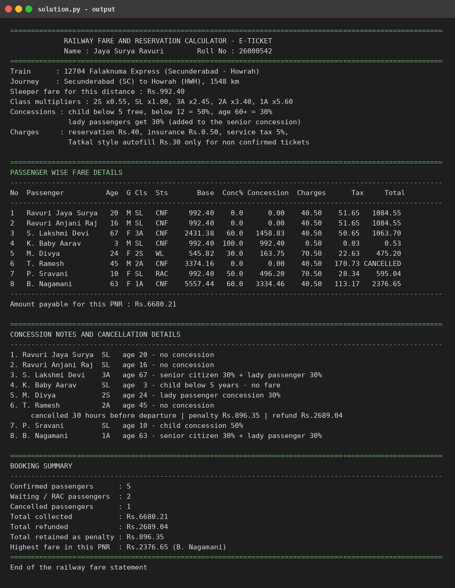

# Case Study 06 — Railway Fare and Reservation Calculator

**Name:** Jaya Surya Ravuri · **Roll No:** 26000542
**Subject:** Python Programming — Activity-Based Learning

Repository home: [Python-Activity-Based-Learning](../README.md)

---

## 1. Problem Statement

A railway booking counter needs a program that can prepare the fare of a whole
PNR (all the passengers of one ticket). The fare depends on the distance
travelled, the travel class, the age and gender of the passenger, the booking
status and, if the ticket is cancelled, on how many hours before departure the
cancellation was made.

The program must

1. Calculate the **sleeper base fare** from the distance using progressive
   distance slabs.
2. Multiply it by the **class multiplier** (2S, SL, 3A, 2A, 1A).
3. Apply the **age / gender concession**:
   - below 5 years → no fare at all,
   - below 12 years → 50 %,
   - 60 years and above → 30 %, and a lady passenger gets another 30 % on top,
   - other lady passengers → 30 %.
4. Add the reservation fee, the insurance premium and, for a non-confirmed
   ticket (WL / RAC), the autofill charge; then add 5 % service tax.
5. Apply the **cancellation penalty** from the hours-before-departure slabs and
   calculate the refund.
6. Print the passenger-wise table, the concession notes, the cancellation
   details and a booking summary.

### Rules used

| Item | Value |
|---|---|
| Distance | 1548 km (Secunderabad → Howrah) |
| Distance slabs (per km) | 1–200: ₹0.85, 201–500: ₹0.72, 501–1000: ₹0.61, 1001–2000: ₹0.55, above 2000: ₹0.48 |
| Class multiplier | 2S ×0.55, SL ×1.00, 3A ×2.45, 2A ×3.40, 1A ×5.60 |
| Reservation fee | ₹40 per passenger |
| Insurance | ₹0.50 per passenger |
| Autofill | ₹30 only for WL / RAC |
| Service tax | 5 % |
| Cancellation | >48 h: 10 %, 24–48 h: 25 %, 12–24 h: 50 %, 4–12 h: 75 %, <4 h: 90 % |

## 2. Objectives

- Store a passenger as a **tuple** of eight fields and unpack it.
- Use a **list of tuples** both for the distance slabs and for the cancellation
  slabs, so that adding a slab later needs no code change.
- Practise nested **conditional statements** for the concession rules.
- Build the final fare step by step so that every charge is visible.
- Return many values from a function as a **list** and read them back by index.
- Produce a properly aligned table with `%` formatting and string repetition.

## 3. Assumptions

- One train and one journey (1548 km) is used for the whole program.
- The distance slabs are progressive, exactly like the electricity slabs: the
  higher rate applies only to the kilometres that fall in that slab.
- The child below 5 years also does not pay any reservation fee.
- The lady passenger concession of 30 % is **added** to the senior citizen
  concession, so a senior lady gets 60 % in total.
- The autofill charge is applied only when the status is not `CNF`.
- The cancelled passenger pays nothing now; the amount already paid is refunded
  after deducting the penalty.
- All passenger names and details are hypothetical sample data.

## 4. Algorithm

```
STEP 1  START
STEP 2  SET train details, distance = 1548 km
        DEFINE DISTANCE_SLABS, CLASS_MULTIPLIER, CANCELLATION_SLABS
        SET RESERVATION_FEE = 40, SERVICE_TAX = 5%, INSURANCE = 0.50,
            AUTOFILL = 30, CHILD_AGE = 5, YOUTH_AGE_LIMIT = 12, SENIOR_AGE = 60
STEP 3  READ the passenger list
STEP 4  REPEAT for every passenger
        4.1  UNPACK passenger -> line, name, age, gender, class, status,
                                 cancelled, hours
        4.2  base = SLAB_FARE(distance) * CLASS_MULTIPLIER(class)
        4.3  (percent, note) = CONCESSION(age, gender)
        4.4  concession = base * percent / 100
        4.5  fare = base - concession
        4.6  reservation = 40 ; IF age < 5 THEN reservation = 0
        4.7  autofill = 30 IF status is not "CNF" ELSE 0
        4.8  subtotal = fare + reservation + 0.50 + autofill
        4.9  tax = subtotal * 5 / 100
        4.10 total = subtotal + tax
        4.11 IF cancelled = "yes" THEN
                 (percent, note) = PENALTY(hours)
                 penalty = total * percent / 100
                 refund  = total - penalty
                 total   = 0
        4.12 store the whole result list
STEP 5  PRINT the passenger-wise fare table
STEP 6  PRINT the concession notes and the cancellation details
STEP 7  PRINT the booking summary (confirmed, waiting, cancelled, totals,
        highest fare)
STEP 8  STOP

FUNCTION SLAB_FARE(distance)
    fare = 0
    FOR each (lower, upper, rate) in DISTANCE_SLABS
        IF distance <= lower - 1 THEN exit loop
        IF upper = -1 THEN km = distance - lower + 1
        ELSE IF distance > upper THEN km = upper - lower + 1
        ELSE km = distance - lower + 1
        fare = fare + km * rate
    RETURN fare
END FUNCTION
```

## 5. Flowchart

The full flowchart is in [`../FLOWCHARTS.md`](../FLOWCHARTS.md#6-railway-fare-and-reservation-calculator).
Short version:

```
       START
         |
  read train details + passenger list
         |
  +--> for each passenger
  |      |
  |   base = slab fare x class multiplier
  |      |
  |   age < 5 ?   YES -> 100% concession
  |   age < 12 ?  YES -> 50%
  |   age >= 60 ? YES -> 30% (+30% if lady)
  |   lady ?      YES -> 30%
  |      |
  |   fare = base - concession
  |   + reservation + insurance (+ autofill if WL/RAC)
  |   + 5% service tax = total
  |      |
  |   cancelled ? YES -> penalty by hours, refund = total - penalty
  |      |
  |   print the passenger row
  |      |
  +------+---------------------------------+
         |
  print concession + cancellation details
         |
  print booking summary
         |
        STOP
```

## 6. Pseudocode

```
BEGIN
    FOR EACH passenger IN PASSENGERS DO
        (line, name, age, gender, cls, status, cancelled, hours) <- passenger

        base <- SLAB_FARE(DISTANCE_KM) * CLASS_MULTIPLIER(cls)

        IF age < CHILD_AGE THEN
            percent <- 100 ; note <- "infant, no fare"
        ELSE IF age < YOUTH_AGE_LIMIT THEN
            percent <- 50 ; note <- "child concession"
        ELSE IF age >= SENIOR_AGE THEN
            percent <- 30
            IF gender = "F" THEN percent <- percent + 30 END IF
            note <- "senior concession"
        ELSE IF gender = "F" THEN
            percent <- 30 ; note <- "lady concession"
        ELSE
            percent <- 0 ; note <- "no concession"
        END IF

        concession <- base * percent / 100
        fare <- base - concession

        reservation <- RESERVATION_FEE
        IF age < CHILD_AGE THEN reservation <- 0 END IF
        autofill <- 0
        IF status <> "CNF" THEN autofill <- AUTOFILL_CHARGE END IF

        subtotal <- fare + reservation + INSURANCE_PREMIUM + autofill
        tax <- subtotal * SERVICE_TAX_PERCENT / 100
        total <- subtotal + tax

        penalty <- 0 ; refund <- 0 ; penalty_note <- ""
        IF cancelled = "yes" THEN
            FOR EACH (limit, pct) IN CANCELLATION_SLABS DO
                IF hours > limit THEN
                    penalty <- total * pct / 100
                    refund <- total - penalty
                    EXIT FOR
                END IF
            END FOR
            total <- 0
        END IF

        DISPLAY line, name, age, gender, cls, status, base, percent,
                concession, total
    END FOR

    DISPLAY concession and cancellation notes
    DISPLAY confirmed count, waiting count, cancelled count,
            total collected, total refund, highest fare
END
```

## 7. Python Source Code

The program is in [`solution.py`](solution.py).

```bash
python3 solution.py
```

## 8. Test Cases

The test file is [`test_cases.py`](test_cases.py).

| # | Test | Input | Expected |
|---|------|-------|----------|
| TC-01..04 | Distance slabs | 200 / 500 / 1000 / 1548 km | 170.00 / 386.00 / 691.00 / 992.40 |
| TC-05 | Open ended slab | 2500 km | more than 2000 km fare |
| TC-06 | Zero distance | 0 km | 0.00 |
| TC-07..10 | Class multipliers | SL / 2S / 1A / unknown | 1.00 / 0.55 / 5.60 / 1.00 |
| TC-11 | Adult male | 20 M | 0 % |
| TC-12 | Infant | 3 M | 100 % |
| TC-13 | Child | 10 F | 50 % |
| TC-14 | Senior male | 65 M | 30 % |
| TC-15 | Senior lady | 67 F | 60 % |
| TC-16 | Young lady | 24 F | 30 % |
| TC-17 | Boundary | 12 M | 0 % |
| TC-18 | Boundary | 60 M | 30 % |
| TC-19..23 | Cancellation slabs | 60 / 30 / 18 / 6 / 1 hours | 10 / 25 / 50 / 75 / 90 % |
| TC-24 | Adult sleeper fare | PNR line 1 | 1,084.55 |
| TC-25 | No autofill for CNF | line 1 | 0.00 |
| TC-26 | Autofill for WL | line 5 | 30.00 |
| TC-27 | Infant fare | line 4 | 0.53 |
| TC-28..30 | Cancellation | line 6 | payable 0, refund 2,689.04, penalty 896.35 |
| TC-31 | Highest fare | all | 2,376.65 |
| TC-32 | Counting | all | exactly 1 cancelled |

Result:

```
Passed : 32        Failed : 0
All test cases passed.
```

## 9. Output

```
No  Passenger          Age  G Cls  Sts       Base  Conc% Concession  Charges      Tax     Total
--------------------------------------------------------------------------------------------------------
1   Ravuri Jaya Surya   20  M SL   CNF     992.40    0.0      0.00    40.50    51.65   1084.55
2   Ravuri Anjani Raj   16  M SL   CNF     992.40    0.0      0.00    40.50    51.65   1084.55
3   S. Lakshmi Devi     67  F 3A   CNF    2431.38   60.0   1458.83    40.50    50.65   1063.70
4   K. Baby Aarav        3  M SL   CNF     992.40  100.0    992.40     0.50     0.03      0.53
5   M. Divya            24  F 2S   WL      545.82   30.0    163.75    70.50    22.63    475.20
6   T. Ramesh           45  M 2A   CNF    3374.16    0.0      0.00    40.50   170.73 CANCELLED
7   P. Sravani          10  F SL   RAC     992.40   50.0    496.20    70.50    28.34    595.04
8   B. Nagamani         63  F 1A   CNF    5557.44   60.0   3334.46    40.50   113.17   2376.65
--------------------------------------------------------------------------------------------------------
Amount payable for this PNR : Rs.6680.21

Confirmed passengers      : 5
Waiting / RAC passengers  : 2
Cancelled passengers      : 1
Total collected           : Rs.6680.21
Total refunded            : Rs.2689.04
Total retained as penalty : Rs.896.35
Highest fare in this PNR  : Rs.2376.65 (B. Nagamani)
```

The complete output is in [`output.txt`](output.txt) and the screenshot is
[`output_screenshot.png`](output_screenshot.png).



## 10. Conclusion

The fare of the whole PNR was calculated successfully and every rule of the
railway tariff was verified with the 32 test cases. The distance slabs gave a
sleeper base fare of ₹992.40 for 1548 km, and the class multipliers then spread
the fares from ₹545.82 (2S) to ₹5,557.44 (1A). The concession rules behaved as
designed: the 3-year-old child paid only 53 paise (insurance plus tax), the
67-year-old lady in 3A ended up paying less than an adult male in sleeper, and
the WL passenger paid the extra autofill charge. One cancellation happened 30
hours before departure, so a 25 % penalty of ₹896.35 was retained and ₹2,689.04
was refunded. Keeping the slabs as tuples of data rather than hard coded `if`
statements made the program much shorter and easier to check.
