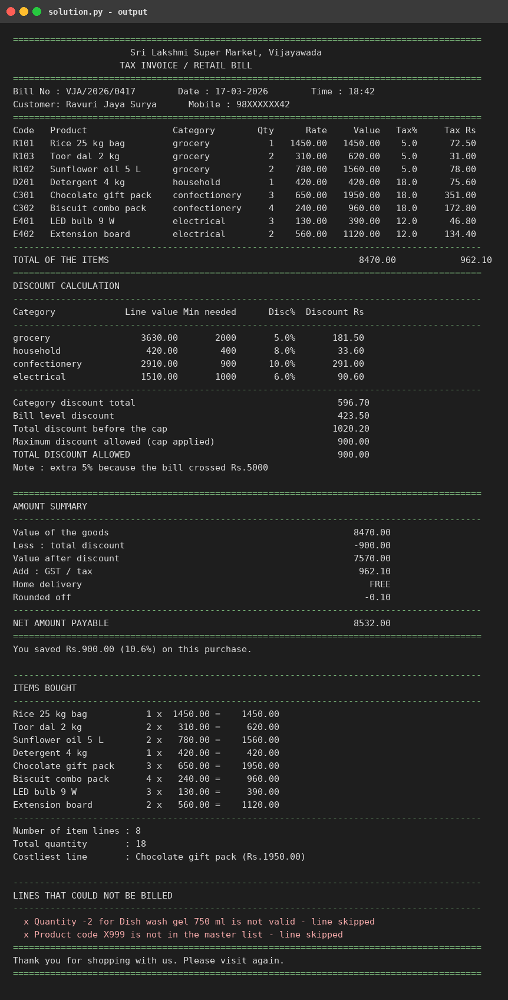

# Case Study 07 — Retail Billing with Multiple Discount Rules

**Name:** Jaya Surya Ravuri · **Roll No:** 26000542
**Subject:** Python Programming — Activity-Based Learning

Repository home: [Python-Activity-Based-Learning](../README.md)

---

## 1. Problem Statement

A super market wants a billing program that can take a **basket** (a list of
product codes and quantities), look up each product in the master list, apply
the category-wise taxes, apply several discount rules and print an itemised tax
invoice.

The program must

1. Look up every product code in the master list and **skip** a line if the code
   is unknown or the quantity is not valid, reporting the skipped lines at the
   end of the bill.
2. Compute the value of each line (`rate × quantity`) and the tax on it
   (category tax percent).
3. Apply a **category discount** when the total value of that category crosses
   its limit:
   - grocery ≥ ₹2,000 → 5 %
   - household ≥ ₹400 → 8 %
   - confectionery ≥ ₹900 → 10 %
   - electrical ≥ ₹1,000 → 6 %
4. Apply an **extra bill-level discount of 5 %** when the value of the goods
   crosses ₹5,000.
5. Restrict the total discount to a **maximum of ₹900**.
6. Add the home delivery charge of ₹60 only when the value after discount is
   below ₹3,000, and round the final amount.
7. Print the invoice with a discount working, an amount summary and an item list.

## 2. Objectives

- Keep the product master as a **list of tuples** and search it with a loop.
- Read the basket as a list of `(code, quantity)` pairs using **tuple
  unpacking**.
- Accumulate category totals in a **dictionary** (a list of keys with a parallel
  value would also work, but a dictionary keeps the code short).
- Use several **conditional statements** for the discount rules and the cap.
- Validate the input and report the bad lines instead of stopping the program.
- Format a real-looking invoice with aligned columns.

## 3. Assumptions

- The shop sells only the nine products given in the master list.
- A quantity of zero or less is invalid and the line is skipped.
- The category discount is applied on the **line value without tax**, and the
  tax is charged on the full line value (discount does not reduce the tax).
- The bill-level discount also uses the gross value of the goods, not the value
  after the category discount.
- The ₹900 cap applies to the **sum** of both discounts.
- The rounding adjustment is the difference between the exact payable amount
  and the nearest rupee.
- All products, prices and the customer name are hypothetical sample data.

## 4. Algorithm

```
STEP 1  START
STEP 2  READ PRODUCTS (code, name, category, price, tax%) and BASKET (code, qty)
        SET CATEGORY_DISCOUNTS, BILL_DISCOUNT_THRESHOLD = 5000,
            BILL_DISCOUNT_PERCENT = 5, MAX_DISCOUNT_AMOUNT = 900,
            HOME_DELIVERY_CHARGE = 60, FREE_DELIVERY_ABOVE = 3000
STEP 3  SET items = [], errors = [], category_totals = {}, gross = 0, tax = 0
STEP 4  REPEAT for every (code, qty) in BASKET
        4.1  product = SEARCH(code) in PRODUCTS
        4.2  IF product is not found -> add an error message, continue
        4.3  IF qty <= 0             -> add an error message, continue
        4.4  value = price * qty ; line_tax = value * tax% / 100
        4.5  PRINT the line
        4.6  add the line to items
        4.7  category_totals[category] = category_totals[category] + value
        4.8  gross = gross + value ; tax = tax + line_tax
STEP 5  IF items is empty -> PRINT message and STOP
STEP 6  PRINT the total of the items and the total tax
STEP 7  category_discount_total = 0
        FOR every category in category_totals
            7.1  percent = DISCOUNT_PERCENT(category, line_value)
            7.2  discount = line_value * percent / 100
            7.3  PRINT the row, add discount to category_discount_total
STEP 8  IF gross >= 5000 THEN bill_discount = gross * 5 / 100 ELSE 0
STEP 9  total_discount = category_discount_total + bill_discount
        IF total_discount > 900 THEN total_discount = 900 (cap applied)
STEP 10 net_value = gross - total_discount
        delivery = 60 IF net_value < 3000 ELSE 0
        payable = net_value + tax + delivery
        rounded = ROUND(payable) ; rounding = rounded - payable
STEP 11 PRINT the amount summary, the savings and the item list
STEP 12 PRINT the skipped lines
STEP 13 STOP
```

## 5. Flowchart

The full flowchart is in
[`../FLOWCHARTS.md`](../FLOWCHARTS.md#7-retail-billing-with-multiple-discount-rules).
Short version:

```
        START
          |
  read product master + basket
          |
  +--> for each basket line
  |      |
  |   product found and qty > 0 ? --NO--> record the error, skip line
  |      | YES
  |   value = rate x qty , tax = value x tax%
  |   add to category totals, gross, tax
  |      |
  +------+----------------------------+
          |
   print the item table + totals
          |
   for each category : discount if the line value crosses the limit
          |
   gross >= 5000 ? --YES--> extra 5% bill discount
          |
   total discount > 900 ? --YES--> cap at 900
          |
   net = gross - discount
   delivery charged only if net < 3000
   payable = net + tax + delivery, rounded
          |
   print amount summary, savings, item list
          |
   print the skipped lines
          |
         STOP
```

## 6. Pseudocode

```
BEGIN
    items <- [] ; errors <- [] ; category_totals <- {}
    gross <- 0 ; tax <- 0

    FOR EACH (code, qty) IN BASKET DO
        product <- FIND_PRODUCT(code)
        IF product = NULL THEN
            ADD "unknown code " + code TO errors ; CONTINUE
        END IF
        IF qty <= 0 THEN
            ADD "invalid quantity for " + product.name TO errors ; CONTINUE
        END IF

        (pcode, name, category, price, tax_percent) <- product
        value <- price * qty
        line_tax <- value * tax_percent / 100

        DISPLAY pcode, name, category, qty, price, value, line_tax
        ADD (pcode, name, category, qty, price, value, line_tax) TO items
        category_totals[category] <- category_totals[category] + value
        gross <- gross + value
        tax <- tax + line_tax
    END FOR

    DISPLAY "total of the items", gross, tax

    category_discount_total <- 0
    FOR EACH category IN category_totals DO
        line_value <- category_totals[category]
        percent <- 0
        FOR EACH (cat, minimum, pct) IN CATEGORY_DISCOUNTS DO
            IF cat = category AND line_value >= minimum THEN
                percent <- pct
            END IF
        END FOR
        discount <- line_value * percent / 100
        category_discount_total <- category_discount_total + discount
        DISPLAY category, line_value, percent, discount
    END FOR

    IF gross >= BILL_DISCOUNT_THRESHOLD THEN
        bill_discount <- gross * BILL_DISCOUNT_PERCENT / 100
    ELSE
        bill_discount <- 0
    END IF

    total_discount <- category_discount_total + bill_discount
    IF total_discount > MAX_DISCOUNT_AMOUNT THEN
        total_discount <- MAX_DISCOUNT_AMOUNT
    END IF

    net_value <- gross - total_discount
    delivery <- 0
    IF net_value < FREE_DELIVERY_ABOVE THEN
        delivery <- HOME_DELIVERY_CHARGE
    END IF

    payable <- net_value + tax + delivery
    rounded <- ROUND(payable)

    DISPLAY "amount summary" : gross, discount, net_value, tax, delivery, rounded
    DISPLAY "savings" : total_discount, total_discount / gross * 100
    DISPLAY item list and the skipped lines
END
```

## 7. Python Source Code

The program is in [`solution.py`](solution.py).

```bash
python3 solution.py
```

## 8. Test Cases

The test file is [`test_cases.py`](test_cases.py).

| # | Test | Input | Expected |
|---|------|-------|----------|
| TC-01 | Known product | R101 | found |
| TC-02 | Unknown product | X999 | None |
| TC-03 | Price of R101 | 1450.00 | matches |
| TC-04 | Tax of D201 | 18 % | matches |
| TC-05 | Grocery above limit | 3,630 | 5 % |
| TC-06 | Grocery below limit | 1,999 | 0 % |
| TC-07 | Exactly on the limit | 2,000 | 5 % |
| TC-08 | Household | 420 | 8 % |
| TC-09 | Confectionery | 2,910 | 10 % |
| TC-10 | Electrical below limit | 390 | 0 % |
| TC-11 | Unknown category | furniture | 0 % |
| TC-12 | Valid basket lines | 10 lines | 8 valid |
| TC-13 | Rejected lines | 10 lines | 2 rejected |
| TC-14..16 | Category totals | basket | 3,630 / 2,910 / 1,510 |
| TC-17 | Gross value | basket | 8,470.00 |
| TC-18 | Total tax | basket | 962.10 |
| TC-19 | Category discount | basket | 596.70 |
| TC-20 | Bill discount | 8,470 × 5 % | 423.50 |
| TC-21 | Discount cap | 1,020.20 | 900.00 |
| TC-22 | Net payable | round(...) | 8,532 |
| TC-23 | Free delivery | net ≥ 3,000 | free |
| TC-24 | Delivery charge | small bill | 60 |
| TC-25 | Costliest line | chocolate gift pack | 1,950.00 |

Result:

```
Passed : 25        Failed : 0
All test cases passed.
```

## 9. Output

```
Code   Product                Category        Qty      Rate     Value   Tax%     Tax Rs
R101   Rice 25 kg bag         grocery           1   1450.00   1450.00    5.0      72.50
R103   Toor dal 2 kg          grocery           2    310.00    620.00    5.0      31.00
R102   Sunflower oil 5 L      grocery           2    780.00   1560.00    5.0      78.00
D201   Detergent 4 kg         household         1    420.00    420.00   18.0      75.60
C301   Chocolate gift pack    confectionery     3    650.00   1950.00   18.0     351.00
C302   Biscuit combo pack     confectionery     4    240.00    960.00   18.0     172.80
E401   LED bulb 9 W           electrical        3    130.00    390.00   12.0      46.80
E402   Extension board        electrical        2    560.00   1120.00   12.0     134.40
----------------------------------------------------------------------------------------
TOTAL OF THE ITEMS                                               8470.00            962.10
...
Category discount total                                      596.70
Bill level discount                                          423.50
Total discount before the cap                               1020.20
Maximum discount allowed (cap applied)                       900.00
TOTAL DISCOUNT ALLOWED                                       900.00

Value of the goods                                              8470.00
Less : total discount                                           -900.00
Value after discount                                            7570.00
Add : GST / tax                                                  962.10
Home delivery                                                      FREE
Rounded off                                                       -0.10
NET AMOUNT PAYABLE                                              8532.00

LINES THAT COULD NOT BE BILLED
  x Quantity -2 for Dish wash gel 750 ml is not valid - line skipped
  x Product code X999 is not in the master list - line skipped
```

The complete output is in [`output.txt`](output.txt) and the screenshot is
[`output_screenshot.png`](output_screenshot.png).



## 10. Conclusion

The invoice was generated correctly for the ten-line basket, out of which eight
lines were billed and two were rejected (a negative quantity and an unknown
product code), which shows how a validation step protects the rest of the bill.
Three of the four categories crossed their discount limits, so the category
discount came to ₹596.70, and because the goods value crossed ₹5,000 an extra 5 % of ₹423.50
was also due. The combined discount of ₹1,020.20 was then cut down to the
maximum of ₹900, which is exactly what the shop's policy demands. The customer
finally paid ₹8,532.00 after tax, delivery and rounding. The most useful part of
this case study was seeing how the order of the rules changes the answer — if
the cap had been checked before adding the bill-level discount, the customer
would have received the full ₹1,020.20.
