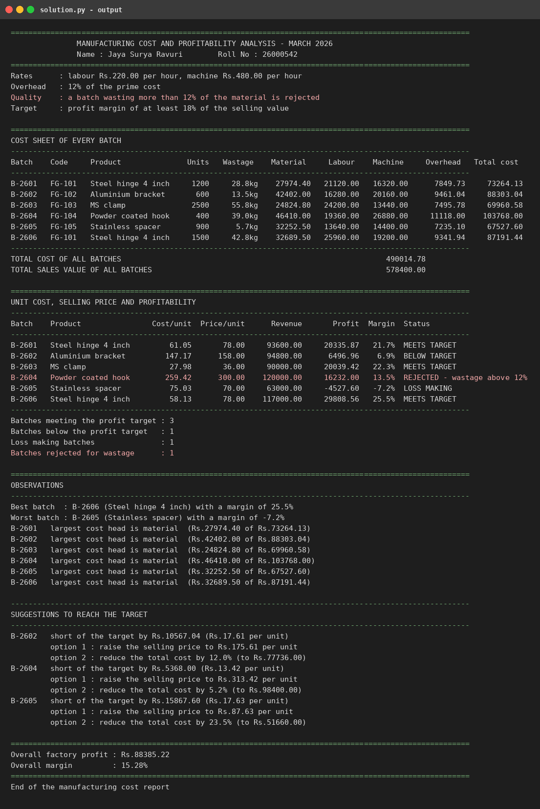

# Case Study 08 — Manufacturing Cost and Profitability Analysis

**Name:** Jaya Surya Ravuri · **Roll No:** 26000542
**Subject:** Python Programming — Activity-Based Learning

Repository home: [Python-Activity-Based-Learning](../README.md)

---

## 1. Problem Statement

A small engineering workshop produces six batches of five different products in
a month. For every batch the material, labour and machine costs have to be
worked out, the factory overhead added, the cost per unit compared with the
selling price, and finally it has to be decided whether the batch is profitable
enough, loss making or unacceptable because of too much wastage.

The program must

1. Calculate the wastage and use only the **usable material** for the material
   cost.
2. Compute `material + labour + machine = prime cost`, add **12 % factory
   overhead** to get the total cost, and then the cost per unit.
3. Compute the revenue from the selling price and the profit and margin of every
   batch.
4. Classify every batch as **MEETS TARGET** (margin ≥ 18 %),
   **BELOW TARGET**, **LOSS MAKING** or **REJECTED** (wastage > 12 %).
5. Identify the batch with the **best and the worst margin** and the **largest
   cost head** of each batch.
6. Print the corrections needed to reach the target margin — the price to be
   raised or the cost reduction needed.
7. Print the overall factory profit and margin.

### Cost data of a batch

`(batch_no, product_code, units, material_kg, material_rate, labour_hours,
machine_hours, wastage_percent)`

Rates: labour ₹220 per hour, machine ₹480 per hour, overhead 12 % of the prime
cost, wastage limit 12 %, target margin 18 %.

## 2. Objectives

- Store the product master and the batch register as **lists of tuples** and read
  them with **tuple unpacking**.
- Build a full cost sheet step by step with **operators**.
- Use **conditional statements** for a four-way classification.
- Use **string formatting** to print a readable cost sheet with many columns.
- Compare all batches with a loop to find the maximum and the minimum margin.
- Return many computed values from a function as a list.

## 3. Assumptions

- The wastage is a percentage of the material purchased, so the money spent on
  the wasted material is lost.
- The overhead is a percentage of the prime cost (material + labour + machine),
  not of the selling price.
- The selling price per unit is fixed by the marketing department and is not
  calculated from the cost.
- A batch with more than 12 % wastage is treated as rejected even if it earns a
  profit, because of the quality policy.
- The classification checks the rejection condition first, then the profit, then
  the target margin.
- All product names, prices and batch quantities are hypothetical sample data.

## 4. Algorithm

```
STEP 1  START
STEP 2  SET LABOUR_RATE = 220, MACHINE_RATE = 480, OVERHEAD = 12%,
        MAX_WASTAGE = 12%, TARGET_MARGIN = 18%
STEP 3  READ PRODUCTS (code, name, price) and BATCHES
STEP 4  REPEAT for every batch
        4.1  UNPACK batch -> batch_no, code, units, material_kg, material_rate,
                             labour_hours, machine_hours, wastage_percent
        4.2  (name, price) = SEARCH code in PRODUCTS
        4.3  wastage_kg = material_kg * wastage_percent / 100
        4.4  usable_kg  = material_kg - wastage_kg
        4.5  material = usable_kg * material_rate
        4.6  labour   = labour_hours * LABOUR_RATE
        4.7  machine  = machine_hours * MACHINE_RATE
        4.8  prime = material + labour + machine
        4.9  overhead = prime * OVERHEAD / 100
        4.10 total = prime + overhead
        4.11 cost_per_unit = total / units
        4.12 revenue = units * price
        4.13 profit  = revenue - total
        4.14 margin  = profit / revenue * 100
        4.15 IF wastage_percent > MAX_WASTAGE -> status = REJECTED
             ELSE IF profit <= 0               -> status = LOSS MAKING
             ELSE IF margin < TARGET_MARGIN    -> status = BELOW TARGET
             ELSE                              -> status = MEETS TARGET
        4.16 add the whole cost sheet to the results list
STEP 5  PRINT the cost sheet table and the totals of all batches
STEP 6  PRINT the unit cost, price, revenue, profit, margin and status table
STEP 7  COUNT how many batches fall in each status
STEP 8  FIND the batch with the highest and the lowest margin
STEP 9  FOR every batch FIND the largest of material / labour / machine
STEP 10 FOR every batch below the target PRINT the price increase and the cost
        reduction needed
STEP 11 PRINT the overall factory profit and margin
STEP 12 STOP
```

## 5. Flowchart

The full flowchart is in
[`../FLOWCHARTS.md`](../FLOWCHARTS.md#8-manufacturing-cost-and-profitability-analysis).
Short version:

```
       START
         |
  read rates, product master, batch register
         |
  +--> for each batch
  |      |
  |   unpack the batch record
  |      |
  |   wastage = material x wastage%
  |   usable  = material - wastage
  |      |
  |   material, labour, machine costs
  |   prime = material + labour + machine
  |   overhead = 12% of prime
  |   total = prime + overhead
  |      |
  |   cost/unit, revenue, profit, margin
  |      |
  |   wastage > 12% ? --YES--> REJECTED ---+
  |   profit <= 0 ?   --YES--> LOSS        |
  |   margin < 18% ?  --YES--> BELOW       |
  |   else                 --> MEETS       |
  |                                        |
  |   print the cost sheet row             |
  +----------------------------------------+
         |
  print unit cost / margin table + counts
         |
  find the best and the worst batch, largest cost head
         |
  print the corrections needed for the weak batches
         |
  print the overall factory profit and margin
         |
        STOP
```

## 6. Pseudocode

```
BEGIN
    results <- empty list

    FOR EACH batch IN BATCHES DO
        (batch_no, code, units, material_kg, material_rate,
         labour_hours, machine_hours, wastage_percent) <- batch

        (name, price) <- FIND_PRODUCT(code)

        wastage_kg <- material_kg * wastage_percent / 100
        usable_kg  <- material_kg - wastage_kg

        material <- usable_kg * material_rate
        labour   <- labour_hours * LABOUR_RATE_PER_HOUR
        machine  <- machine_hours * MACHINE_HOUR_RATE

        prime    <- material + labour + machine
        overhead <- prime * OVERHEAD_PERCENT / 100
        total    <- prime + overhead

        cost_per_unit <- total / units
        revenue <- units * price
        profit  <- revenue - total
        margin  <- profit / revenue * 100

        IF wastage_percent > MAX_WASTAGE_PERCENT THEN
            status <- "REJECTED"
        ELSE IF profit <= 0 THEN
            status <- "LOSS MAKING"
        ELSE IF margin < TARGET_MARGIN_PERCENT THEN
            status <- "BELOW TARGET"
        ELSE
            status <- "MEETS TARGET"
        END IF

        ADD [batch_no, code, name, units, price, wastage_kg, material,
             labour, machine, prime, overhead, total, cost_per_unit,
             revenue, profit, margin, status] TO results
    END FOR

    DISPLAY cost sheet of every batch
    DISPLAY total cost and total sales value
    DISPLAY unit cost, price, revenue, profit, margin and status
    COUNT the batches in each status
    FIND the best and the worst batch by margin
    FOR EACH batch DO
        DISPLAY the largest cost head
        IF margin < TARGET_MARGIN THEN
            gap <- revenue * TARGET / 100 - profit
            DISPLAY gap, gap / units, price + gap / units
            DISPLAY the cost reduction percent needed
        END IF
    END FOR
    DISPLAY overall profit and margin
END
```

## 7. Python Source Code

The program is in [`solution.py`](solution.py).

```bash
python3 solution.py
```

## 8. Test Cases

The test file is [`test_cases.py`](test_cases.py).

| # | Test | Input | Expected |
|---|------|-------|----------|
| TC-01 | Product lookup | FG-103 | MS clamp, ₹36 |
| TC-02 | Unknown product | FG-999 | None, 0 |
| TC-03 | Wastage kilograms | 6 % of 480 kg | 28.80 kg |
| TC-04 | Material cost | 451.2 kg × ₹62 | 27,974.40 |
| TC-05 | Labour cost | 96 h × ₹220 | 21,120.00 |
| TC-06 | Machine cost | 34 h × ₹480 | 16,320.00 |
| TC-07 | Prime cost | – | 65,414.40 |
| TC-08 | Overhead | 12 % | 7,849.73 |
| TC-09 | Total cost | – | 73,264.13 |
| TC-10 | Cost per unit | 1,200 units | 61.05 |
| TC-11 | Revenue | 1,200 × ₹78 | 93,600.00 |
| TC-12 | Profit | – | 20,335.87 |
| TC-13 | Margin | – | 21.7 % |
| TC-14 | Status | B-2601 | MEETS TARGET |
| TC-15 | Rejection | B-2604, 15 % wastage | REJECTED |
| TC-16 | Loss making | B-2605 | LOSS MAKING |
| TC-17 | Below target | B-2602 | BELOW TARGET |
| TC-18 | Cost per unit | B-2604 | 259.42 |
| TC-19 | Largest cost head | all batches | material |
| TC-20 | Total = prime + overhead | all | true |
| TC-21 | Profit = revenue − cost | all | true |
| TC-22 | Counting | 6 batches | 3 meet the target |
| TC-23 | Total cost | all | 4,90,014.78 |
| TC-24 | Total sales value | all | 5,78,400.00 |
| TC-25 | Overall profit | all | 88,385.22 |
| TC-26 | Best batch | all | B-2606, 25.5 % |

Result:

```
Passed : 26        Failed : 0
All test cases passed.
```

## 9. Output

```
COST SHEET OF EVERY BATCH
--------------------------------------------------------------------------------------------------------
Batch    Code     Product               Units   Wastage    Material     Labour    Machine     Overhead   Total cost
--------------------------------------------------------------------------------------------------------
B-2601   FG-101   Steel hinge 4 inch     1200     28.8kg    27974.40   21120.00   16320.00      7849.73     73264.13
B-2602   FG-102   Aluminium bracket       600     13.5kg    42402.00   16280.00   20160.00      9461.04     88303.04
B-2603   FG-103   MS clamp               2500     55.8kg    24824.80   24200.00   13440.00      7495.78     69960.58
B-2604   FG-104   Powder coated hook      400     39.0kg    46410.00   19360.00   26880.00     11118.00    103768.00
B-2605   FG-105   Stainless spacer        900      5.7kg    32252.50   13640.00   14400.00      7235.10     67527.60
B-2606   FG-101   Steel hinge 4 inch     1500     42.8kg    32689.50   25960.00   19200.00      9341.94     87191.44
--------------------------------------------------------------------------------------------------------
TOTAL COST OF ALL BATCHES                                                            490014.78
TOTAL SALES VALUE OF ALL BATCHES                                                     578400.00

B-2601   Steel hinge 4 inch         61.05       78.00     93600.00     20335.87   21.7%  MEETS TARGET
B-2602   Aluminium bracket         147.17      158.00     94800.00      6496.96    6.9%  BELOW TARGET
B-2603   MS clamp                   27.98       36.00     90000.00     20039.42   22.3%  MEETS TARGET
B-2604   Powder coated hook        259.42      300.00    120000.00     16232.00   13.5%  REJECTED - wastage above 12%
B-2605   Stainless spacer            75.03       70.00     63000.00     -4527.60   -7.2%  LOSS MAKING
B-2606   Steel hinge 4 inch         58.13       78.00    117000.00     29808.56   25.5%  MEETS TARGET

SUGGESTIONS TO REACH THE TARGET
B-2602   short of the target by Rs.10567.04 (Rs.17.61 per unit)
         option 1 : raise the selling price to Rs.175.61 per unit
         option 2 : reduce the total cost by 12.0% (to Rs.77736.00)
...
Overall factory profit : Rs.88385.22
Overall margin         : 15.28%
```

The complete output is in [`output.txt`](output.txt) and the screenshot is
[`output_screenshot.png`](output_screenshot.png).



## 10. Conclusion

The cost sheet of all six batches was prepared and the profitability of the
month was analysed. Three batches (B-2601, B-2603 and B-2606) comfortably cross
the 18 % target, B-2602 falls short with only 6.9 %, B-2605 actually runs into a
loss of ₹4,527.60, and B-2604 is rejected because 15 % of its material is wasted
even though it earns a profit of ₹16,232. The factory as a whole makes a profit
of ₹88,385.22 on sales of ₹5,78,400, which is a margin of 15.28 % — below the
18 % target, mainly because of the loss making stainless spacer batch. The
observations also showed that material is the largest cost head in every single
batch, so the fastest way to improve the margin is to reduce wastage rather than
to bargain for labour. Working with a long tuple and a long list of results was
good practice for keeping the code readable; a comment for the index of every
value would have made it even clearer.
