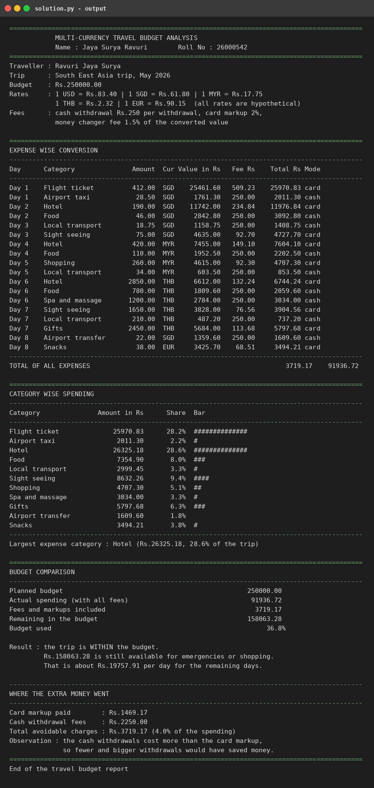

# Case Study 09 — Multi-Currency Travel Budget Analysis

**Name:** Jaya Surya Ravuri · **Roll No:** 26000542
**Subject:** Python Programming — Activity-Based Learning

Repository home: [Python-Activity-Based-Learning](../README.md)

---

## 1. Problem Statement

A traveller going on an eight day trip to Singapore, Malaysia and Thailand wants
to know how much the trip actually costs in Indian rupees and whether the
planned budget is enough. Every expense is recorded in the local currency and
has to be converted with the exchange rate of that currency, and the conversion
itself costs money — a card payment has a bank markup, a cash withdrawal has a
flat fee and a money changer charges a commission.

The program must

1. Convert every expense into rupees using the exchange rate table, and add the
   fee that belongs to the payment mode of that expense.
2. Skip an expense (with a message) if its currency is not in the rate table.
3. Add up the total spending and the total fees.
4. Group the spending **category-wise**, show the share of every category with a
   simple bar of `#` characters, and flag a category that crosses 40 %.
5. Identify the **largest expense category**.
6. Compare the total with the planned budget and report the amount remaining or
   overspent, along with the percentage of the budget used.
7. Show how much of the extra money went into card markups and cash withdrawal
   fees, and which of the two is more expensive.

### Rates and fees used

| Currency | Value in ₹ |
|---|---|
| INR | 1.00 |
| USD | 83.40 |
| SGD | 61.80 |
| MYR | 17.75 |
| THB | 2.32 |
| EUR | 90.15 |

Fees — cash withdrawal: ₹250 flat; card payment: 2 % markup; money changer:
1.5 % of the converted value. Planned budget: ₹2,50,000.

## 2. Objectives

- Keep the exchange rates as a **list of tuples** `(code, rate)`.
- Keep the expenses as a **list of mixed-type tuples** and unpack five values.
- Write a small `convert_to_inr` function that returns three values in a **list**.
- Accumulate category totals in a **dictionary** and print a text bar chart.
- Compare the total with the budget using a **conditional statement** and handle
  both the within-budget and the over-budget case.
- Practise aligned output with `%` formatting and `end=""` printing.

## 3. Assumptions

- Only one exchange rate per currency is used for the whole trip; the rates are
  hypothetical and do not change during the trip.
- Every cash expense is a separate withdrawal, so the flat ₹250 fee applies to
  every cash line (a real traveller would withdraw once for several days, and
  the program points this out).
- The card markup is charged on the rupee value of the transaction.
- The money changer mode is used for any mode other than `card` and `cash`.
- The expense total includes the fees, because the traveller really pays them.
- The trip is treated as 8 days when the daily pocket money is worked out.
- All amounts, rates and names are hypothetical sample data.

## 4. Algorithm

```
STEP 1  START
STEP 2  SET budget = 250000, ATM fee = 250, card markup = 2%,
        dealer fee = 1.5%, warning share = 40%
STEP 3  READ EXCHANGE_RATES (code, rate) and EXPENSES
        (day, category, amount, currency, mode)
STEP 4  SET rows = [], grand_total = 0, total_fees = 0
STEP 5  REPEAT for every expense
        5.1  UNPACK expense -> day, category, amount, currency, mode
        5.2  rate = SEARCH currency in EXCHANGE_RATES
        5.3  IF rate not found -> PRINT error, continue
        5.4  value = amount * rate
        5.5  IF mode = "cash"  THEN fee = 250
             ELSE IF mode = "card" THEN fee = value * 2 / 100
             ELSE fee = value * 1.5 / 100
        5.6  total = value + fee
        5.7  PRINT the row
        5.8  add the row to rows, grand_total += total, total_fees += fee
STEP 6  PRINT the total of all expenses
STEP 7  BUILD category_totals from rows
STEP 8  FOR every category
        8.1  share = category_total / grand_total * 100
        8.2  bar = share / 2 characters of "#"
        8.3  PRINT the row, mark HIGH if share > 40
STEP 9  FIND the category with the largest total
STEP 10 IF grand_total <= budget THEN
            PRINT remaining amount, budget used %, per day money
        ELSE
            PRINT overspent amount and the category to cut
STEP 11 SPLIT the fees into card markup and cash withdrawal fees and PRINT the
        comparison
STEP 12 STOP
```

## 5. Flowchart

The full flowchart is in
[`../FLOWCHARTS.md`](../FLOWCHARTS.md#9-multi-currency-travel-budget-analysis).
Short version:

```
       START
         |
  read budget, rates, expenses
         |
  +--> for each expense
  |      |
  |   currency in the rate table ? --NO--> flag the line, skip
  |      | YES
  |   value = amount x rate
  |   fee by payment mode (cash / card / dealer)
  |   total = value + fee
  |   add to the category total and the grand total
  |      |
  +------+----------------------------+
         |
  print the expense table and the totals
         |
  for each category : share % and a bar of #
         |
  find the largest category
         |
  grand total <= budget ?
     YES -> remaining money + per day
     NO  -> overspent + which category to cut
         |
  split the fees into card markup / cash fees
         |
        STOP
```

## 6. Pseudocode

```
BEGIN
    rows <- empty list
    grand_total <- 0
    total_fees <- 0

    FOR EACH expense IN EXPENSES DO
        (day, category, amount, currency, mode) <- expense

        rate <- 0
        FOR EACH (code, r) IN EXCHANGE_RATES DO
            IF code = currency THEN rate <- r END IF
        END FOR

        IF rate = 0 THEN
            DISPLAY "no rate for", currency
            CONTINUE
        END IF

        value <- amount * rate

        IF mode = "cash" THEN
            fee <- ATM_FEE_PER_WITHDRAWAL
        ELSE IF mode = "card" THEN
            fee <- value * CARD_MARKUP_PERCENT / 100
        ELSE
            fee <- value * CONVERSION_FEE_PERCENT / 100
        END IF

        total <- value + fee
        DISPLAY day, category, amount, currency, value, fee, total, mode

        ADD (day, category, amount, currency, value, fee, total, mode) TO rows
        grand_total <- grand_total + total
        total_fees <- total_fees + fee
    END FOR

    DISPLAY "total of all expenses", total_fees, grand_total

    category_totals <- {}
    FOR EACH row IN rows DO
        category_totals[row.category] <- category_totals[row.category] + row.total
    END FOR

    FOR EACH category IN category_totals DO
        share <- category_totals[category] / grand_total * 100
        DISPLAY category, category_totals[category], share, BAR(share / 2)
        IF share > WARNING_SHARE_PERCENT THEN DISPLAY "HIGH" END IF
    END FOR

    largest <- the category with the maximum total
    DISPLAY "largest category", largest

    IF grand_total <= PLANNED_BUDGET_INR THEN
        DISPLAY "remaining", PLANNED_BUDGET_INR - grand_total
        DISPLAY "budget used", grand_total / PLANNED_BUDGET_INR * 100
    ELSE
        DISPLAY "overspent", grand_total - PLANNED_BUDGET_INR
        DISPLAY "reduce the spending on", largest
    END IF

    card_fees <- sum of the fees of the card rows
    cash_fees <- sum of the fees of the cash rows
    DISPLAY card_fees, cash_fees, total_fees
    IF card_fees < cash_fees THEN
        DISPLAY "cash withdrawals cost more"
    ELSE
        DISPLAY "card markup costs more"
    END IF
END
```

## 7. Python Source Code

The program is in [`solution.py`](solution.py).

```bash
python3 solution.py
```

## 8. Test Cases

The test file is [`test_cases.py`](test_cases.py).

| # | Test | Input | Expected |
|---|------|-------|----------|
| TC-01 | Known rate | USD | 83.40 |
| TC-02 | Rupee rate | INR | 1.00 |
| TC-03 | Unknown currency | JPY | −1 |
| TC-04 | Card conversion | 100 SGD | 6,180.00 |
| TC-05 | Card markup | 2 % | 123.60 |
| TC-06 | Card total | – | 6,303.60 |
| TC-07 | Cash conversion | 100 SGD | 6,180.00 |
| TC-08 | Cash fee | – | 250.00 |
| TC-09 | Cash total | – | 6,430.00 |
| TC-10 | Dealer fee | 1.5 % | 92.70 |
| TC-11 | Dealer total | – | 6,272.70 |
| TC-12 | Unknown currency conversion | JPY | negative |
| TC-13 | Thai baht | 2,850 THB | 6,612.00 |
| TC-14 | Ringgit | 420 MYR | 7,455.00 |
| TC-15 | Euro | 38 EUR | 3,425.70 |
| TC-16 | Zero amount | 0 | zero fee |
| TC-17 | Trip total | 18 lines | 91,936.72 |
| TC-18 | Total fees | 18 lines | 3,719.17 |
| TC-19 | Within budget | ₹2,50,000 | true |
| TC-20 | Money left | – | 1,58,063.28 |
| TC-21 | Hotel total | – | 26,325.18 |
| TC-22 | Food total | – | 7,354.90 |
| TC-23 | Largest category | – | Hotel |
| TC-24 | Warning share | – | below 40 % |
| TC-25 | Fee comparison | – | cash 2,250 > card 1,469.17 |
| TC-26 | Line count | – | 18 |
| TC-27 | Rate availability | – | none missing |

Result:

```
Passed : 27        Failed : 0
All test cases passed.
```

## 9. Output

```
Day      Category               Amount  Cur Value in Rs   Fee Rs    Total Rs Mode
--------------------------------------------------------------------------------------------
Day 1    Flight ticket          412.00  SGD    25461.60   509.23    25970.83 card
Day 1    Airport taxi            28.50  SGD     1761.30   250.00     2011.30 cash
Day 2    Hotel                  190.00  SGD    11742.00   234.84    11976.84 card
...
Day 8    Snacks                  38.00  EUR     3425.70    68.51     3494.21 card
--------------------------------------------------------------------------------------------
TOTAL OF ALL EXPENSES                                                   3719.17    91936.72

Category               Amount in Rs      Share  Bar
--------------------------------------------------------------------------------------------
Flight ticket              25970.83      28.2%  ##############
Hotel                      26325.18      28.6%  ##############
Food                        7354.90       8.0%  ###
...
Largest expense category : Hotel (Rs.26325.18, 28.6% of the trip)

Planned budget                                                250000.00
Actual spending (with all fees)                                91936.72
Remaining in the budget                                       158063.28
Budget used                                                        36.8%

Card markup paid        : Rs.1469.17
Cash withdrawal fees    : Rs.2250.00
Total avoidable charges : Rs.3719.17 (4.0% of the spending)
```

The complete output is in [`output.txt`](output.txt) and the screenshot is
[`output_screenshot.png`](output_screenshot.png).



## 10. Conclusion

All 18 expenses of the trip were converted and the total cost came to
₹91,936.72, which is only 36.8 % of the ₹2,50,000 budget, so the trip is
comfortably within budget and ₹1,58,063.28 is still available. The largest
expense category is the hotel stay (₹26,325.18, 28.6 %) followed very closely by
the flight ticket (₹25,970.83, 28.2 %), and no single category crossed the 40 %
warning level. The interesting finding was in the fee analysis: ₹3,719.17 (4 % of
the whole trip) went into conversion charges, and the flat ₹250 withdrawal fee
cost ₹2,250 in total, which is more than the ₹1,469.17 of card markup — so making
fewer and larger cash withdrawals would have saved money. This case study was a
good exercise in converting the same amount between many currencies and in
comparison logic, which is exactly why travel budgets are a favourite example
for a loop with conditional statements.
