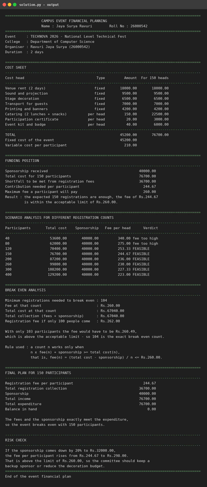

# Case Study 10 — Campus Event Financial Planning

**Name:** Jaya Surya Ravuri · **Roll No:** 26000542
**Subject:** Python Programming — Activity-Based Learning

Repository home: [Python-Activity-Based-Learning](../README.md)

---

## 1. Problem Statement

The department is organising a two day national level technical fest. Some of the
costs are fixed (venue, sound, decoration, transport, printing) and some depend
on the number of participants (catering, certificates, event kit). A sponsorship
amount is promised, and whatever is left has to be collected as a registration
fee. The committee wants to know the fee for the expected number of
registrations, the number of registrations needed to break even, and what
happens if the sponsorship falls short.

The program must

1. Total the **fixed cost heads** and the **variable cost per participant**
   from two lists of tuples.
2. Compute `total cost = fixed + variable × participants`.
3. Compute the **shortfall** after the sponsorship and the **fee per
   participant**.
4. Compare the fee with the maximum fee a participant is willing to pay and say
   whether the plan is feasible.
5. Print a **scenario table** for 40, 80, 120, 150, 200, 260, 300 and 400
   participants.
6. Find the **minimum number of registrations needed to break even** by scanning
   from 1 up to the venue capacity.
7. Print the final plan for the expected count and a **risk check** in which the
   sponsorship drops by 20 %.

### Data used

| Item | Value |
|---|---|
| Fixed costs | Venue ₹18,000 + sound ₹9,500 + decoration ₹6,500 + transport ₹7,000 + printing ₹4,200 = **₹45,200** |
| Per participant | Catering ₹150 + certificate ₹20 + event kit ₹40 = **₹210** |
| Sponsorship | ₹40,000 |
| Expected registrations | 150 |
| Maximum acceptable fee | ₹260 |
| Venue capacity | 400 |

## 2. Objectives

- Read cost heads from two **lists of tuples** with **tuple unpacking**.
- Write functions (`totals`, `total_cost`, `participation_fee`) so the same
  formula is not repeated.
- Use **conditional statements** for the feasibility verdict and the balance.
- Use a `for` loop to search for the **break even** count.
- Guard against division by zero when the count is zero.
- Print a well formatted financial plan with aligned columns.

## 3. Assumptions

- The fixed costs do not change with the number of participants.
- The per participant costs are exactly the same for everybody, so the variable
  cost is simply `per head × participants`.
- Sponsorship is received before the event, so it can be used to reduce the fee.
- The fee is a single amount for all participants (no student / outside
  categories).
- A count is acceptable only when the required fee is **less than or equal to**
  ₹260.
- The venue cannot take more than 400 participants.
- All amounts and the event name are hypothetical sample data.

## 4. Algorithm

```
STEP 1  START
STEP 2  READ FIXED_COSTS and VARIABLE_COSTS (head, amount)
        SET SPONSORSHIP = 40000, MAX_FEE = 260,
            EXPECTED = 150, MAX_PARTICIPANTS = 400
STEP 3  fixed = 0 ; FOR each (head, amount) in FIXED_COSTS -> fixed += amount
        variable = 0 ; FOR each (head, amount) in VARIABLE_COSTS -> variable += amount
STEP 4  DEFINE total_cost(n) = fixed + variable * n
        DEFINE fee(n):
              IF n <= 0 -> 0
              shortfall = total_cost(n) - sponsorship
              IF shortfall <= 0 -> 0
              RETURN shortfall / n
STEP 5  PRINT the cost sheet for the expected count
STEP 6  shortfall = total_cost(EXPECTED) - sponsorship
        IF shortfall <= 0 -> PRINT "fully sponsored" and STOP
        fee = shortfall / EXPECTED
        IF fee <= MAX_FEE -> PRINT "feasible" ELSE PRINT "not feasible"
STEP 7  FOR every count in [40, 80, 120, 150, 200, 260, 300, 400]
            7.1  cost = total_cost(count)
            7.2  f = fee(count)
            7.3  verdict = fully sponsored / FEASIBLE / fee too high
            7.4  PRINT the row
STEP 8  break_even = 0
        FOR count = 1 TO MAX_PARTICIPANTS
              IF fee(count) <= MAX_FEE THEN break_even = count ; exit loop
STEP 9  IF break_even = 0 -> PRINT "cannot break even" and STOP
        PRINT break_even, fee(break_even), total_cost(break_even)
        PRINT the fee for break_even - 1 to show that it is above the limit
STEP 10 PRINT the final plan for the expected count (fee, collection,
        sponsorship, income, expenditure, balance)
STEP 11 RISK CHECK : reduced_sponsorship = 80% of sponsorship,
        reduced_fee = (total_cost(EXPECTED) - reduced_sponsorship) / EXPECTED,
        PRINT whether it is still within the limit
STEP 12 STOP
```

## 5. Flowchart

The full flowchart is in
[`../FLOWCHARTS.md`](../FLOWCHARTS.md#10-campus-event-financial-planning).
Short version:

```
        START
          |
   read cost heads, sponsorship, limits
          |
   fixed = sum of the fixed heads
   variable = sum of the per head costs
          |
   define total_cost(n) and fee(n)
          |
   print the cost sheet for the expected count
          |
   sponsorship >= total cost ? --YES--> fee = 0, fully sponsored
          | NO
   fee = (total cost - sponsorship) / n
          |
   fee <= 260 ? --YES--> feasible  /  NO --> not feasible
          |
   for every count in the scenario list : print cost, fee, verdict
          |
   for n = 1 to 400 : first n with fee(n) <= 260 is the break even count
          |
   print the final plan for the expected count
          |
   sponsorship down 20% ? recompute the fee and compare with the limit
          |
         STOP
```

## 6. Pseudocode

```
BEGIN
    fixed <- 0
    FOR EACH (head, amount) IN FIXED_COSTS DO
        fixed <- fixed + amount
    END FOR

    variable <- 0
    FOR EACH (head, amount) IN VARIABLE_COSTS DO
        variable <- variable + amount
    END FOR

    DISPLAY "fixed cost", fixed
    DISPLAY "variable cost per participant", variable

    count <- EXPECTED_PARTICIPANTS
    cost <- fixed + variable * count
    DISPLAY "total cost for", count, cost

    shortfall <- cost - SPONSORSHIP
    IF shortfall <= 0 THEN
        DISPLAY "fully sponsored, no fee needed"
    ELSE
        fee <- shortfall / count
        DISPLAY "shortfall", shortfall
        DISPLAY "fee per participant", fee
        IF fee <= MAX_PARTICIPATION_FEE THEN
            DISPLAY "plan is feasible"
        ELSE
            DISPLAY "plan is not feasible"
        END IF

        FOR EACH n IN [40, 80, 120, 150, 200, 260, 300, 400] DO
            c <- fixed + variable * n
            f <- (c - SPONSORSHIP) / n
            IF f <= 0 THEN
                DISPLAY n, c, 0, "fully sponsored"
            ELSE IF f <= MAX_PARTICIPATION_FEE THEN
                DISPLAY n, c, f, "FEASIBLE"
            ELSE
                DISPLAY n, c, f, "fee too high"
            END IF
        END FOR

        break_even <- 0
        n <- 1
        WHILE n <= MAX_PARTICIPANTS AND break_even = 0 DO
            c <- fixed + variable * n
            f <- (c - SPONSORSHIP) / n
            IF f <= MAX_PARTICIPATION_FEE THEN
                break_even <- n
            END IF
            n <- n + 1
        END WHILE

        DISPLAY "minimum registrations to break even", break_even
        DISPLAY "fee at that count", (fixed + variable * break_even - SPONSORSHIP) / break_even

        collected <- fee * count
        balance <- collected + SPONSORSHIP - cost
        DISPLAY "final plan" : fee, collected, SPONSORSHIP, balance
    END IF
END
```

## 7. Python Source Code

The program is in [`solution.py`](solution.py).

```bash
python3 solution.py
```

## 8. Test Cases

The test file is [`test_cases.py`](test_cases.py).

| # | Test | Input | Expected |
|---|------|-------|----------|
| TC-01 | Fixed cost total | cost heads | 45,200.00 |
| TC-02 | Variable cost | cost heads | 210.00 |
| TC-03 | Total cost | 150 participants | 76,700.00 |
| TC-04 | Only fixed cost | 0 participants | 45,200.00 |
| TC-05 | Marginal cost | 150 → 151 | +210.00 |
| TC-06 | Fee | 150 participants | 244.67 |
| TC-07 | Fee | 100 participants | 262.00 |
| TC-08 | Fee | 200 participants | 236.00 |
| TC-09 | Fee decreases with count | 300 vs 200 | smaller |
| TC-10 | Break even count | scan 1–400 | 104 |
| TC-11 | Fee at break even | 104 | 260.00 |
| TC-12 | One less than break even | 103 | above 260 |
| TC-13 | Collection at break even | – | equals the cost |
| TC-14 | Large sponsorship | ₹1,00,000 | fee 0 |
| TC-15 | Zero participants | 0 | fee 0, no crash |
| TC-16 | Expected count feasible | 150 | fee ≤ 260 |
| TC-17 | Low turnout | 40 | fee 340.00 |
| TC-18 | Venue capacity | – | 400 |
| TC-19 | Income = cost | 150 | true |
| TC-20 | 20 % lower sponsorship | ₹32,000 | fee 298.00 |
| TC-21 | Risk check verdict | ₹298 | above the limit |
| TC-22 | Per head costs | all | positive |
| TC-23 | Fixed heads add up | – | equals the total |

Result:

```
Passed : 23        Failed : 0
All test cases passed.
```

## 9. Output

```
Cost head                                  Type         Amount  For 150 heads
--------------------------------------------------------------------------------------------
Venue rent (2 days)                       fixed       18000.00       18000.00
Sound and projection                      fixed        9500.00        9500.00
Stage decoration                          fixed        6500.00        6500.00
Transport for guests                      fixed        7000.00        7000.00
Printing and banners                      fixed        4200.00        4200.00
Catering (2 lunches + snacks)          per head         150.00       22500.00
Participation certificate              per head          20.00        3000.00
Event kit and badge                    per head          40.00        6000.00
--------------------------------------------------------------------------------------------
TOTAL                                                 45200.00       76700.00

Sponsorship received                                           40000.00
Total cost for 150 participants                                76700.00
Shortfall to be met from registration fees                     36700.00
Contribution needed per participant                              244.67

Participants       Total cost    Sponsorship   Fee per head      Verdict
--------------------------------------------------------------------------------------------
40                   53600.00       40000.00         340.00 fee too high
80                   62000.00       40000.00         275.00 fee too high
120                  70400.00       40000.00         253.33 FEASIBLE
150                  76700.00       40000.00         244.67 FEASIBLE
200                  87200.00       40000.00         236.00 FEASIBLE
...
Minimum registrations needed to break even : 104
Fee at that count                          : Rs.260.00

Registration fee per participant                                 244.67
Total registration collection                                  36700.00
Sponsorship                                                    40000.00
Total income                                                   76700.00
Total expenditure                                              76700.00
Balance in hand                                                    0.00

If the sponsorship comes down by 20% to Rs.32000.00,
the fee per participant rises from Rs.244.67 to Rs.298.00.
```

The complete output is in [`output.txt`](output.txt) and the screenshot is
[`output_screenshot.png`](output_screenshot.png).



## 10. Conclusion

The financial plan of the fest was prepared and checked for many possible
registration counts. The fixed cost of the event is ₹45,200 and each participant
adds ₹210, so with 150 registrations the total cost is ₹76,700. The ₹40,000
sponsorship leaves a shortfall of ₹36,700, which works out to ₹244.67 per
participant — inside the acceptable limit of ₹260, so the plan is feasible. The
break even analysis showed that at least **104 registrations** are needed; at 103
registrations the fee would have to be ₹260.49, which is just above the limit,
which is a nice example of how a single participant decides the whole budget.
The risk check showed that if the sponsorship drops by 20 % the fee jumps to
₹298 and the plan fails, so the committee should line up a backup sponsor or cut
the decoration budget. Dividing the shortfall by the participant count was the
only potentially dangerous step, so the program checks for a zero count before
dividing, and that is the main thing I learnt from this case study.
